# Java Streams - Revision Notes

> Common sample data used in all examples:
```java
List<Integer> nums = List.of(5, 3, 8, 1, 9, 3, 6);
List<String> names = List.of("john", "alice", "bob", "alice", "charlie");
record Emp(int id, String name, String dept, double salary, int age) {}
List<Emp> emps = List.of(
    new Emp(1, "John",  "IT",  50000, 30),
    new Emp(2, "Alice", "HR",  60000, 28),
    new Emp(3, "Bob",   "IT",  70000, 35),
    new Emp(4, "Carol", "HR",  45000, 40),
    new Emp(5, "Dave",  "OPS", 80000, 45));
```

---

# 1. LAMBDAS (the confusing part, made simple)

## One-line meaning
A lambda is a **short anonymous function**: "given THESE inputs, do THIS".

```
(inputs) -> output/body
```

Read `->` as **"goes to"** / **"then do"**.

## Why they exist
Java needs an *object* to pass behaviour. Earlier you wrote a whole anonymous class. A lambda is the same thing without the noise.

```java
// OLD
Comparator<String> c = new Comparator<String>() {
    public int compare(String a, String b) { return a.length() - b.length(); }
};
// NEW
Comparator<String> c = (a, b) -> a.length() - b.length();
```

## Where can a lambda be used? -> only where a **Functional Interface** is expected
Functional interface = interface with **exactly ONE abstract method**. The lambda *is* the implementation of that method.

| Interface | Method | Meaning (memorize this) | Lambda example |
|---|---|---|---|
| `Predicate<T>` | `boolean test(T)` | **Yes/No question** (filter) | `x -> x > 5` |
| `Function<T,R>` | `R apply(T)` | **Convert** T to R (map) | `s -> s.length()` |
| `Consumer<T>` | `void accept(T)` | **Use it, return nothing** (forEach) | `x -> System.out.println(x)` |
| `Supplier<T>` | `T get()` | **Give me a value, no input** (generate) | `() -> new ArrayList<>()` |
| `UnaryOperator<T>` | `T apply(T)` | Convert T to same T | `s -> s.toUpperCase()` |
| `BinaryOperator<T>` | `T apply(T,T)` | Combine two into one (reduce) | `(a, b) -> a + b` |
| `BiFunction<T,U,R>` | `R apply(T,U)` | two inputs -> result | `(a, b) -> a * b` |
| `Comparator<T>` | `int compare(T,T)` | Ordering (sorted) | `(a, b) -> a - b` |

**Trick to remember:** ask "what does the stream method want from me?"
- `filter` wants a **question** -> Predicate
- `map` wants a **converter** -> Function
- `forEach` wants an **action** -> Consumer
- `reduce` wants a **combiner** -> BinaryOperator
- `sorted` wants a **comparer** -> Comparator
- `generate` wants a **factory** -> Supplier

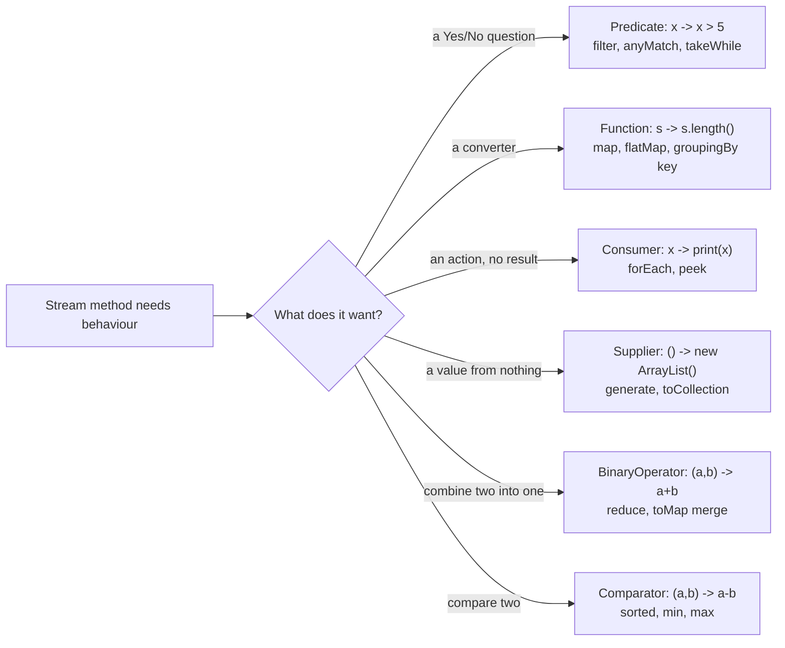

## Syntax rules
```java
x -> x * 2                    // 1 param, no () needed, no return/braces for single expression
(x, y) -> x + y               // 2+ params need ()
() -> 42                      // no params need ()
(int x, int y) -> x + y       // types optional (compiler infers)
x -> { int sq = x * x; return sq; }  // block body: needs braces AND return
```
Rule: **braces `{}` => you must write `return` (if a value is expected) and `;`**.

## Examples by type
```java
Predicate<Integer> isEven = n -> n % 2 == 0;
isEven.test(4);                              // true

Function<String,Integer> len = s -> s.length();
len.apply("hello");                          // 5

Consumer<String> printer = s -> System.out.println(s);
printer.accept("hi");

Supplier<Double> rnd = () -> Math.random();

BinaryOperator<Integer> add = (a, b) -> a + b;
add.apply(2, 3);                             // 5

Comparator<Emp> bySalary = (a, b) -> Double.compare(a.salary(), b.salary());
```

## Rules / gotchas
1. Lambda can use outer variables only if they are **effectively final** (never reassigned).
```java
int count = 0;
list.forEach(x -> count++);   // COMPILE ERROR
// Use AtomicInteger or a stream operation (count()) instead
```
2. `this` inside lambda = enclosing class (not the lambda).
3. Lambda has no name; type comes from the **target** (where it's assigned/passed).
4. Lambda parameter names can't clash with local variable names in the same scope.

## How to "read" a lambda while coding
`emps.stream().filter(e -> e.salary() > 50000)`
-> "for each `e` (an Emp) keep it **if** salary > 50000". The param name is just a nickname for **one element** of the stream.

---

# 2. METHOD REFERENCES (`::`)

## Meaning
A method reference is a **shortcut for a lambda that only calls ONE existing method**.
> If your lambda is just "take the input and pass it to some method" -> use `::`

```
Class::method      // no parentheses!
```

## The 4 types (memorize with the lambda equivalent)

| # | Type | Syntax | Lambda equivalent | Rule |
|---|---|---|---|---|
| 1 | **Static method** | `Integer::parseInt` | `s -> Integer.parseInt(s)` | arg is passed to static method |
| 2 | **Instance method of a particular object** | `System.out::println` | `x -> System.out.println(x)` | object is fixed, arg passed to it |
| 3 | **Instance method of an arbitrary object of a type** | `String::length` | `s -> s.length()` | **the arg itself is the object** calling method |
| 4 | **Constructor** | `ArrayList::new` | `() -> new ArrayList<>()` | creates new object |

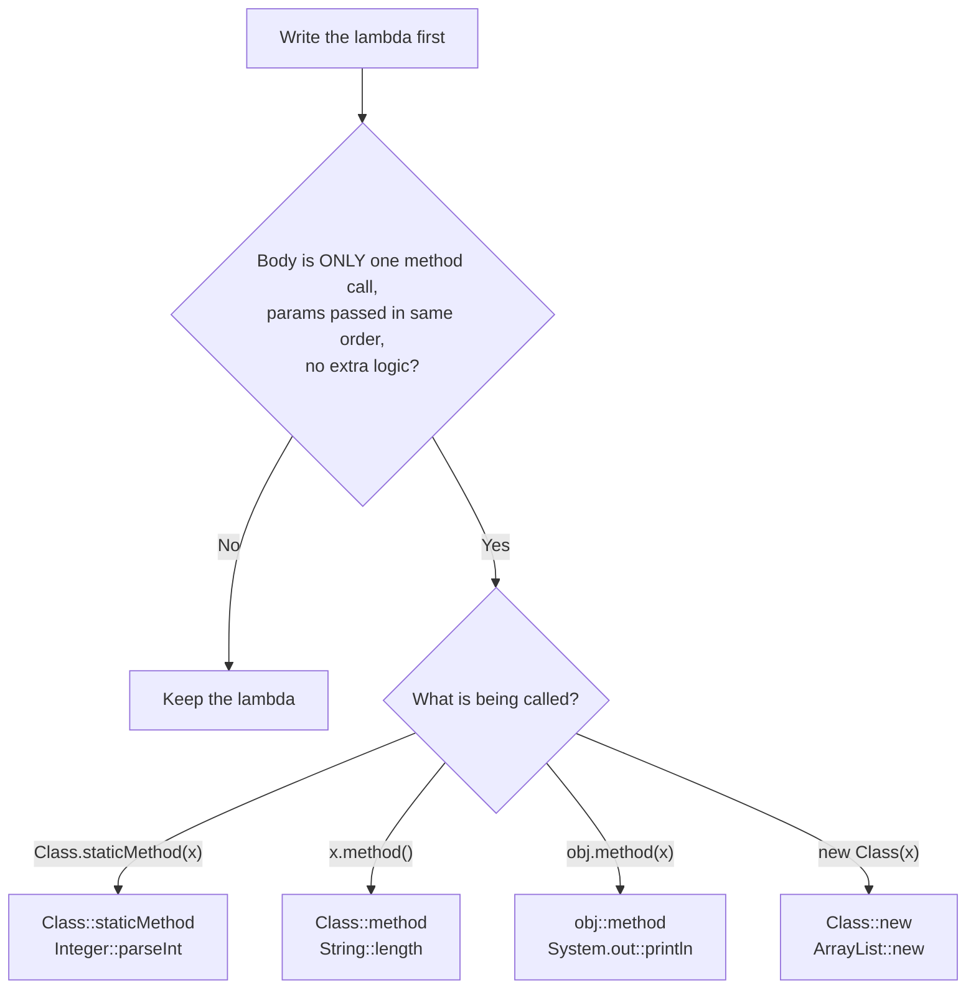

### Type 1 - Static
```java
List<Integer> r = List.of("1","2","3").stream().map(Integer::parseInt).toList();
// s -> Integer.parseInt(s)
Math::abs, String::valueOf, Integer::sum, Integer::compare
```

### Type 2 - Particular object
```java
names.forEach(System.out::println);           // System.out is the fixed object
String prefix = "Hi ";
names.stream().map(prefix::concat);           // x -> prefix.concat(x)
```

### Type 3 - Arbitrary object (most confusing!)
```java
names.stream().map(String::toUpperCase);      // s -> s.toUpperCase()
names.stream().map(String::length);           // s -> s.length()
emps.stream().map(Emp::name);                 // e -> e.name()
emps.stream().sorted(Comparator.comparing(Emp::salary));
```
Two-arg version: `String::compareTo` == `(a, b) -> a.compareTo(b)` (first arg is the object, second the parameter).

### Type 4 - Constructor
```java
Supplier<List<String>> s = ArrayList::new;               // () -> new ArrayList<>()
Function<String, Emp2> f = Emp2::new;                    // name -> new Emp2(name)
names.stream().map(StringBuilder::new);                  // s -> new StringBuilder(s)
Stream.of(1,2,3).toArray(Integer[]::new);                // n -> new Integer[n]
Collectors.toCollection(TreeSet::new);
```

## The decision checklist (use when stuck)
1. Write the lambda first.
2. Is the body **only one method call** using the parameters **in the same order**, nothing else (no `+ 1`, no `> 5`)?
   - YES -> convert to `::`
   - NO -> keep lambda.
3. Which type?
   - `Class.staticMethod(x)` -> `Class::staticMethod`
   - `x.method()` -> `ClassOfX::method`
   - `obj.method(x)` -> `obj::method`
   - `new Class(x)` -> `Class::new`

**Can't use `::`:** `x -> x * 2`, `x -> x > 5`, `e -> e.salary() > 5000` (extra logic).

---

# 3 & 4. WAYS OF CREATING STREAMS (with examples)

| # | Way | Use when |
|---|---|---|
| 1 | `collection.stream()` | you have List/Set/Queue |
| 2 | `collection.parallelStream()` | big data, CPU heavy |
| 3 | `Arrays.stream(array)` | you have an array |
| 4 | `Stream.of(a, b, c)` | few known values / array of objects |
| 5 | `Stream.empty()` | return empty stream safely |
| 6 | `Stream.ofNullable(x)` | single value that may be null |
| 7 | `Stream.iterate(seed, f)` | infinite/ordered sequence (1,2,3...) |
| 8 | `Stream.iterate(seed, hasNext, next)` | sequence with end condition (like a for loop) |
| 9 | `Stream.generate(supplier)` | infinite random/constant values |
| 10 | `Stream.builder()` | add elements step by step |
| 11 | `Stream.concat(s1, s2)` | merge two streams |
| 12 | `IntStream.range / rangeClosed` | numbers in a range (replaces for loop) |
| 13 | `String.chars()` | stream of characters (as ints) |
| 14 | `Map.entrySet().stream()` / `keySet()` / `values()` | iterate a map |
| 15 | `Files.lines(path)` / `BufferedReader.lines()` | read file lines |
| 16 | `Pattern.splitAsStream(str)` / `Arrays.stream(str.split(","))` | split a string |
| 17 | `new Random().ints(n, lo, hi)` | random numbers |
| 18 | `StreamSupport.stream(iterable.spliterator(), false)` | from an `Iterable` |
| 19 | `Optional.stream()` | optional -> 0 or 1 element stream |

```java
// 1. Collection
Stream<Integer> s1 = nums.stream();

// 2. Parallel
Stream<Integer> s2 = nums.parallelStream();

// 3. Array (works for int[] -> IntStream)
int[] arr = {1, 2, 3};
IntStream s3 = Arrays.stream(arr);
Stream<String> s3b = Arrays.stream(new String[]{"a","b"});
Arrays.stream(arr, 1, 3);               // from index 1 to 2

// 4. Stream.of
Stream<String> s4 = Stream.of("a", "b", "c");

// 5. empty
Stream<String> s5 = Stream.empty();

// 6. ofNullable
Stream<String> s6 = Stream.ofNullable(null);       // empty stream, no NPE

// 7. iterate (infinite!! must limit)
Stream.iterate(1, x -> x * 2).limit(5);            // 1 2 4 8 16

// 8. iterate with condition (Java 9)
Stream.iterate(1, x -> x <= 10, x -> x + 3);       // 1 4 7 10

// 9. generate (infinite!! must limit)
Stream.generate(() -> "hi").limit(3);              // hi hi hi
Stream.generate(Math::random).limit(2);

// 10. builder
Stream<String> s10 = Stream.<String>builder().add("a").add("b").build();

// 11. concat
Stream.concat(Stream.of(1,2), Stream.of(3,4));     // 1 2 3 4

// 12. range
IntStream.range(0, 5);          // 0 1 2 3 4   (end exclusive)
IntStream.rangeClosed(1, 5);    // 1 2 3 4 5   (end inclusive)

// 13. chars
"hello".chars();                                   // IntStream of ascii codes
"hello".chars().mapToObj(c -> (char) c);           // Stream<Character>

// 14. Map
Map<String,Integer> m = Map.of("a", 1, "b", 2);
m.entrySet().stream(); m.keySet().stream(); m.values().stream();

// 15. File
try (Stream<String> lines = Files.lines(Path.of("a.txt"))) { lines.forEach(System.out::println); }

// 16. Split string
Arrays.stream("a,b,c".split(","));
Pattern.compile(",").splitAsStream("a,b,c");

// 17. Random
new Random().ints(5, 1, 100);                      // 5 random ints between 1..99

// 18. Iterable
StreamSupport.stream(nums.spliterator(), false);

// 19. Optional
Optional.of("x").stream();
```
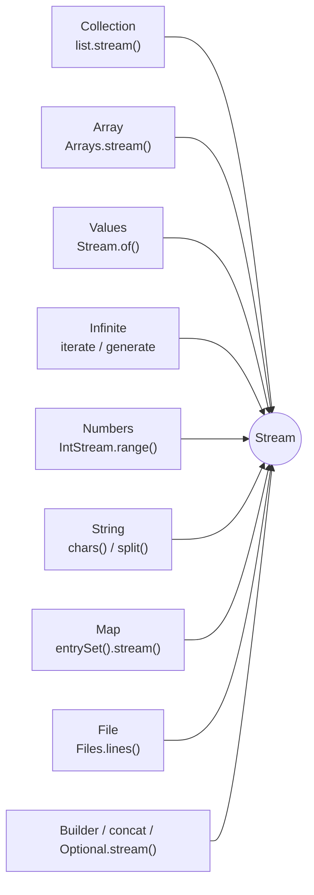

**Remember:** A stream can be consumed **only once**. Reusing -> `IllegalStateException`.

---

# STREAM PIPELINE = 3 PARTS

```
SOURCE  ->  INTERMEDIATE ops (0 or many)  ->  TERMINAL op (exactly 1)
list.stream().filter(..).map(..).sorted()   .collect(..)
```
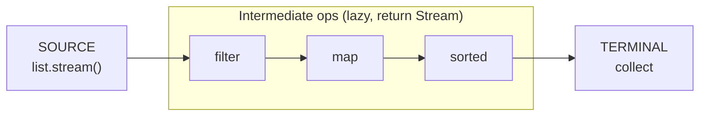

Laziness: elements move through the pipeline one at a time.
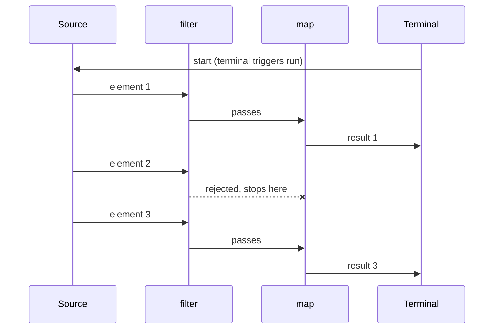

- **Intermediate** = returns a Stream, **lazy** (nothing runs until a terminal op).
- **Terminal** = returns a result/void, **triggers** the whole pipeline, closes the stream.
- Elements flow **one by one** through the whole pipeline (vertical processing), not stage by stage (except `sorted`, which must see everything).

---

# 5 & 6. INTERMEDIATE OPERATIONS

| Op | Input -> Output | One-line purpose |
|---|---|---|
| `filter(Predicate)` | T -> T | keep elements that pass the test |
| `map(Function)` | T -> R | transform each element 1-to-1 |
| `mapToInt/Long/Double` | T -> primitive | map to primitive stream (enables `sum`, `average`) |
| `mapToObj` | int -> Object | primitive stream -> object stream |
| `boxed` | int -> Integer | primitive stream -> wrapper stream |
| `asLongStream/asDoubleStream` | int -> long/double | widen primitive streams |
| `flatMap(Function->Stream)` | T -> many R | flatten nested collections |
| `flatMapToInt` etc. | T -> IntStream | flatten into primitive stream |
| `mapMulti(BiConsumer)` | T -> 0..n R | like flatMap, imperative style (Java 16) |
| `distinct()` | T -> T | remove duplicates (uses equals/hashCode) |
| `sorted()` / `sorted(Comparator)` | T -> T | order elements |
| `peek(Consumer)` | T -> T | debug/look without changing |
| `limit(n)` | T -> T | first n only |
| `skip(n)` | T -> T | drop first n |
| `takeWhile(Predicate)` | T -> T | take until first failure (Java 9) |
| `dropWhile(Predicate)` | T -> T | drop until first failure, keep rest (Java 9) |
| `parallel()/sequential()/unordered()/onClose()` | - | stream mode/config |

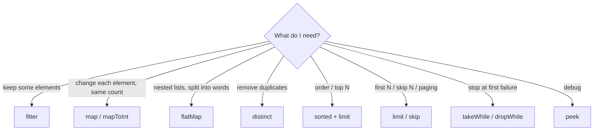

### filter - "keep if true"
```java
nums.stream().filter(n -> n > 5).toList();                 // [8, 9, 6]
emps.stream().filter(e -> e.dept().equals("IT")).toList(); // John, Bob
```
Use when: "find all / only / having / greater than / starting with".

### map - "change each element into something else" (count stays same)
```java
names.stream().map(String::toUpperCase).toList();          // JOHN, ALICE...
emps.stream().map(Emp::name).toList();                     // get names from employees
nums.stream().map(n -> n * n).toList();                    // squares
```
Use when: "extract a field", "convert", "square", "uppercase".

### mapToInt / mapToLong / mapToDouble - map into a primitive stream
```java
emps.stream().mapToDouble(Emp::salary).sum();              // total salary
names.stream().mapToInt(String::length).max();             // OptionalInt
```
Use when: you need **sum / average / min / max / summaryStatistics** (avoid boxing).

### mapToObj - primitive -> object
```java
IntStream.rangeClosed(1,3).mapToObj(i -> "No" + i).toList();  // [No1, No2, No3]
"abc".chars().mapToObj(c -> (char) c).toList();                // [a, b, c]
```

### boxed - int -> Integer (needed before `collect(groupingBy..)` / `toList` from IntStream)
```java
IntStream.range(0,3).boxed().toList();                     // [0,1,2]
```

### flatMap - "flatten": each element becomes a stream, all streams merged into one
```java
List<List<Integer>> nested = List.of(List.of(1,2), List.of(3), List.of(4,5));
nested.stream().flatMap(List::stream).toList();            // [1,2,3,4,5]

List<String> sentences = List.of("hi there", "good day");
sentences.stream().flatMap(s -> Arrays.stream(s.split(" "))).toList(); // [hi, there, good, day]
```
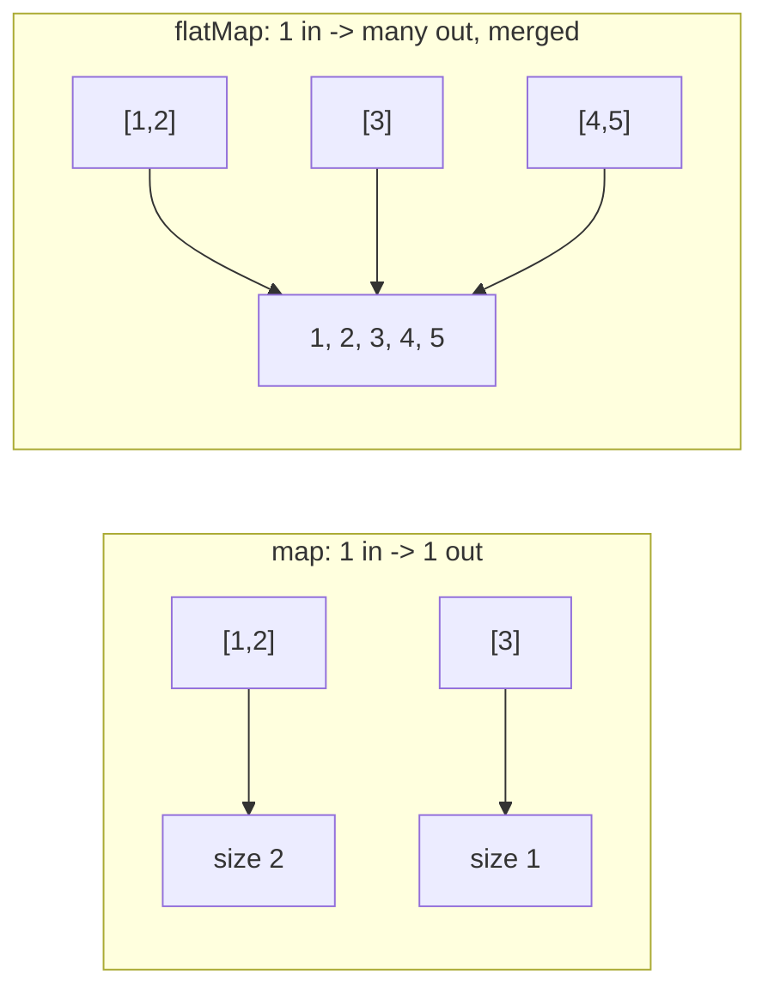

**map vs flatMap:** `map` = 1 in -> 1 out. `flatMap` = 1 in -> 0..many out, then flattened.
Use when you see **List of Lists, split sentences into words, words into chars**.

### mapMulti - like flatMap, push results yourself
```java
Stream.of(1, 2, 3).<Integer>mapMulti((n, sink) -> { if (n != 2) { sink.accept(n); sink.accept(n * 10); } })
     .toList();                                            // [1, 10, 3, 30]
```

### distinct - remove duplicates
```java
nums.stream().distinct().toList();                         // [5,3,8,1,9,6]
```
For objects, `equals/hashCode` must be defined (records do it automatically).

### sorted - order
```java
nums.stream().sorted().toList();                           // ascending
nums.stream().sorted(Comparator.reverseOrder()).toList();  // descending
emps.stream().sorted(Comparator.comparing(Emp::salary).reversed()).toList();
emps.stream().sorted(Comparator.comparing(Emp::dept).thenComparing(Emp::name)).toList();
```
Use when: "sort / top N / highest / lowest / rank". (Stateful: needs all elements.)

### peek - debug only
```java
nums.stream().peek(n -> System.out.println("before " + n)).filter(n -> n > 5).toList();
```
Don't rely on it for logic.

### limit / skip - pagination, top N
```java
nums.stream().limit(3).toList();                           // [5,3,8]
nums.stream().skip(2).toList();                            // [8,1,9,3,6]
nums.stream().skip(2).limit(3).toList();                   // page: [8,1,9]
```
Top-N pattern: `sorted(desc).limit(N)`. N-th highest: `sorted(desc).skip(N-1).findFirst()`.

### takeWhile / dropWhile - on ordered data, stops at first failure
```java
List.of(1,2,3,10,4,5).stream().takeWhile(n -> n < 5).toList();  // [1,2,3]
List.of(1,2,3,10,4,5).stream().dropWhile(n -> n < 5).toList();  // [10,4,5]
```
Difference from `filter`: filter checks ALL elements; takeWhile **stops** at first false.

### parallel / sequential
```java
nums.stream().parallel().map(n -> n * 2).toList();
```
Only for big, CPU-bound, stateless operations.

---

# 7 & 8. TERMINAL OPERATIONS

| Op | Returns | One-line purpose |
|---|---|---|
| `forEach(Consumer)` | void | do something with each |
| `forEachOrdered` | void | same, keeps encounter order in parallel |
| `collect(Collector)` | any | gather into List/Set/Map/String/groups |
| `toList()` (Java 16) | immutable List | shortcut collect to list |
| `toArray()` | array | to array |
| `reduce(...)` | T / Optional<T> | combine all into one value |
| `count()` | long | number of elements |
| `min(Comparator)` / `max(Comparator)` | Optional<T> | smallest/largest |
| `sum()/average()/min()/max()` | primitive streams only | numeric stats |
| `summaryStatistics()` | stats object | count,sum,min,max,avg in one go |
| `anyMatch(Predicate)` | boolean | at least one matches |
| `allMatch(Predicate)` | boolean | every one matches |
| `noneMatch(Predicate)` | boolean | none match |
| `findFirst()` | Optional<T> | first element |
| `findAny()` | Optional<T> | any element (parallel friendly) |
| `iterator()` | Iterator | manual iteration |

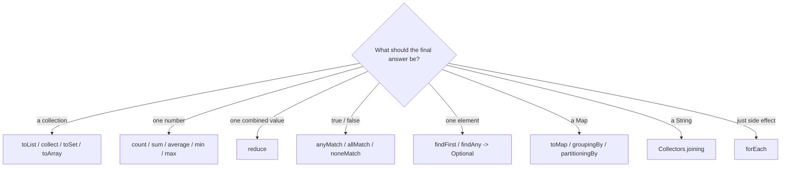

### forEach
```java
names.stream().forEach(System.out::println);
```
Use for printing/side effects. **Don't** use it to build a list (use `collect`).

### collect - the most important
```java
nums.stream().collect(Collectors.toList());
nums.stream().collect(Collectors.toSet());
emps.stream().collect(Collectors.toMap(Emp::id, Emp::name));
// duplicate keys -> exception, give merge fn:
names.stream().collect(Collectors.toMap(n -> n, n -> 1, Integer::sum));  // word count
names.stream().collect(Collectors.joining(", ", "[", "]"));              // [john, alice, ...]
nums.stream().collect(Collectors.counting());
emps.stream().collect(Collectors.summingDouble(Emp::salary));
emps.stream().collect(Collectors.averagingDouble(Emp::salary));
emps.stream().collect(Collectors.groupingBy(Emp::dept));                 // Map<String,List<Emp>>
emps.stream().collect(Collectors.groupingBy(Emp::dept, Collectors.counting()));
emps.stream().collect(Collectors.groupingBy(Emp::dept, Collectors.mapping(Emp::name, Collectors.toList())));
emps.stream().collect(Collectors.partitioningBy(e -> e.salary() > 55000)); // Map<Boolean,List>
emps.stream().collect(Collectors.groupingBy(Emp::dept, Collectors.maxBy(Comparator.comparing(Emp::salary))));
emps.stream().collect(Collectors.toCollection(TreeSet::new));            // specific collection
```
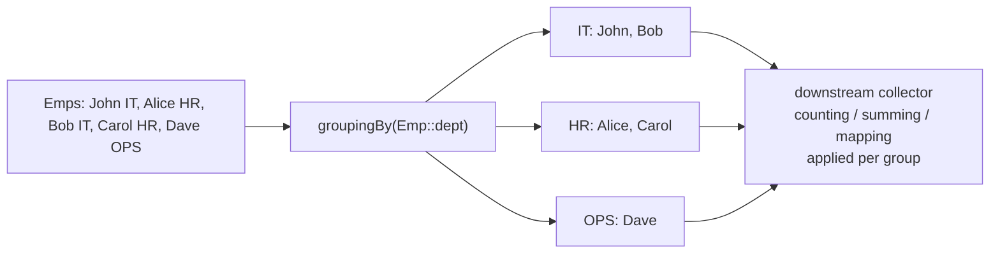

Memory map: **groupingBy = SQL GROUP BY**, **partitioningBy = GROUP BY with true/false only**, **joining = String.join**, **toMap = build dictionary**.

### toList / toArray
```java
List<Integer> l = nums.stream().toList();       // immutable
Integer[] a = nums.stream().toArray(Integer[]::new);
int[] p = nums.stream().mapToInt(i -> i).toArray();
```

### reduce - fold everything into one value
```java
int sum = nums.stream().reduce(0, (a, b) -> a + b);           // with identity: returns int
int sum2 = nums.stream().reduce(0, Integer::sum);
Optional<Integer> max = nums.stream().reduce(Integer::max);   // no identity -> Optional
String joined = names.stream().reduce("", (a, b) -> a + b);
```
How it works: `acc = identity; for each x: acc = f(acc, x)`.
Use when no ready-made op exists (product, concat, custom combine).

### count
```java
emps.stream().filter(e -> e.dept().equals("IT")).count();      // 2
```

### min / max
```java
emps.stream().max(Comparator.comparingDouble(Emp::salary)).get();   // Dave
nums.stream().min(Integer::compare);                                 // Optional[1]
IntStream.of(3,1,2).max().getAsInt();                                // primitive version, no comparator
```

### sum / average / summaryStatistics (primitive streams)
```java
nums.stream().mapToInt(Integer::intValue).sum();
nums.stream().mapToInt(i -> i).average().orElse(0);
IntSummaryStatistics st = nums.stream().mapToInt(i -> i).summaryStatistics();
st.getMin(); st.getMax(); st.getAverage(); st.getSum(); st.getCount();
```

### anyMatch / allMatch / noneMatch (short-circuit)
```java
nums.stream().anyMatch(n -> n > 8);       // true  (at least one)
nums.stream().allMatch(n -> n > 0);       // true  (every)
nums.stream().noneMatch(n -> n > 100);    // true  (zero)
```
On empty stream: `allMatch` = true, `noneMatch` = true, `anyMatch` = false.

### findFirst / findAny
```java
nums.stream().filter(n -> n > 5).findFirst();           // Optional[8]
emps.stream().filter(e -> e.age() > 100).findAny().orElse(null);
```
Always handle `Optional`: `.orElse(x)`, `.orElseThrow()`, `.ifPresent(...)`, `.map(...)`.

### iterator
```java
Iterator<Integer> it = nums.stream().iterator();
```

---

# 9. HOW TO CONNECT THE DOTS (solving any stream problem)

## The 5-step recipe
1. **SOURCE** - What is my data? list/array/map/range/string -> pick the creation way.
2. **GOAL** - What must the final answer look like? (a list? one value? a map? true/false? a count?) -> this picks the **terminal op**.
3. **FILTER** - Are some elements to be ignored? -> `filter`.
4. **TRANSFORM** - Do I need a field / converted value / flattened? -> `map` / `flatMap` / `mapToInt`.
5. **ORDER/LIMIT** - Sorted? top N? unique? -> `sorted`, `distinct`, `limit`, `skip`.

Then write in that order: `source -> filter -> map -> distinct/sorted/limit -> terminal`.

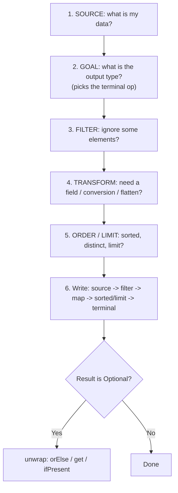

## Goal -> Terminal operation cheat sheet
| Question says... | Use |
|---|---|
| "list of / collect / return all" | `collect(toList())` / `toList()` |
| "how many" | `count()` |
| "total / sum" | `mapToInt/Double().sum()` |
| "average" | `average()` / `averagingX` |
| "highest / lowest / oldest" | `max / min(Comparator)` |
| "first / any / find" | `findFirst / findAny` |
| "is there any / all / none" | `anyMatch / allMatch / noneMatch` |
| "group by / department wise / category wise" | `groupingBy` |
| "split into two (pass/fail, even/odd)" | `partitioningBy` |
| "frequency / count of each / duplicates" | `groupingBy(x -> x, counting())` |
| "join as string" | `Collectors.joining` |
| "key -> value map" | `toMap` |
| "product / custom combine" | `reduce` |
| "top N / Nth highest" | `sorted + limit/skip` |
| "unique" | `distinct` / `toSet` |
| "nested list / words in sentences" | `flatMap` |
| "numbers 1..n" | `IntStream.rangeClosed` |
| "characters in a string" | `chars().mapToObj(c -> (char)c)` |

## Thinking template (write on paper)
```
Input  : List<Emp>
Output : Map<String, Double>   (dept -> avg salary)
Steps  : group by dept  -> average of salary
Code   : emps.stream().collect(groupingBy(Emp::dept, averagingDouble(Emp::salary)))
```
**Trick:** Think of the **type at every step**:
```
List<Emp> -> Stream<Emp> -> filter -> Stream<Emp> -> map(Emp::name) -> Stream<String> -> toList -> List<String>
```
If you know the type after each arrow, the next operation becomes obvious.

## When stuck
- Write the **plain for-loop** solution first, then convert:
  - `if` inside loop -> `filter`
  - `x = something(item)` -> `map`
  - `sum += x` -> `sum()` / `reduce`
  - `list.add(x)` -> `collect/toList`
  - `map.put/merge` -> `groupingBy / toMap`
  - `break` on first match -> `findFirst / anyMatch`
  - nested loop -> `flatMap`
  - `i` from 0..n -> `IntStream.range`
- Return type of `max/min/findFirst/reduce(no identity)` is `Optional` -> always unwrap.
- Need to count something after grouping? `groupingBy(key, counting())`. Sort a map by value? Stream `entrySet()` -> `sorted(Map.Entry.comparingByValue())`.
- Need the index? use `IntStream.range(0, list.size())`.
- Primitive streams (`IntStream`) don't have `collect(toList())`; use `boxed()` or `mapToObj` first.
- Don't modify the source list inside the stream; don't use `forEach` to add into an external list.

## Worked example (end to end)
**Q: Names of the top 2 highest-paid IT/HR employees, uppercase, comma separated.**
1. Source: `emps.stream()`
2. Filter: dept is IT or HR -> `filter(e -> e.dept().equals("IT") || e.dept().equals("HR"))`
3. Order: salary desc -> `sorted(Comparator.comparingDouble(Emp::salary).reversed())`
4. Limit: `limit(2)`
5. Transform: `map(e -> e.name().toUpperCase())`
6. Terminal: `collect(Collectors.joining(", "))`
```java
String r = emps.stream()
    .filter(e -> e.dept().equals("IT") || e.dept().equals("HR"))
    .sorted(Comparator.comparingDouble(Emp::salary).reversed())
    .limit(2)
    .map(e -> e.name().toUpperCase())
    .collect(Collectors.joining(", "));   // BOB, ALICE
```

---

# 10. PRACTICE PROBLEMS (Easy / Medium / Hard) WITH SOLUTIONS

(Data: `nums`, `names`, `emps` as at the top.)

## INTERMEDIATE OPERATIONS

### filter
- **Easy:** Even numbers from list.
  `nums.stream().filter(n -> n % 2 == 0).toList();`
- **Medium:** Names of employees in IT earning > 50000 and age < 40.
  `emps.stream().filter(e -> e.dept().equals("IT") && e.salary() > 50000 && e.age() < 40).map(Emp::name).toList();`
- **Hard:** Strings that are palindromes and have length > 2.
  ```java
  list.stream().filter(s -> s.length() > 2)
      .filter(s -> new StringBuilder(s).reverse().toString().equals(s)).toList();
  ```

### map
- **Easy:** Square of every number.
  `nums.stream().map(n -> n * n).toList();`
- **Medium:** Increase salary of each employee by 10% and return the new salaries.
  `emps.stream().map(e -> e.salary() * 1.1).toList();`
- **Hard:** Convert `List<String>` of `"id:name"` into `Map<Integer,String>`.
  ```java
  list.stream().map(s -> s.split(":"))
      .collect(Collectors.toMap(a -> Integer.parseInt(a[0]), a -> a[1]));
  ```

### mapToInt / mapToDouble
- **Easy:** Sum of all numbers. `nums.stream().mapToInt(Integer::intValue).sum();`
- **Medium:** Average salary of the HR department.
  `emps.stream().filter(e -> e.dept().equals("HR")).mapToDouble(Emp::salary).average().orElse(0);`
- **Hard:** Sum of digits of all numbers in the list.
  ```java
  nums.stream().mapToInt(n -> String.valueOf(n).chars().map(c -> c - '0').sum()).sum();
  ```

### mapToObj / boxed
- **Easy:** `IntStream.rangeClosed(1,5).boxed().toList();`
- **Medium:** First 5 even numbers as strings "E2","E4"...
  `IntStream.rangeClosed(1,5).mapToObj(i -> "E" + (i*2)).toList();`
- **Hard:** Count occurrence of each character in a string.
  ```java
  "banana".chars().mapToObj(c -> (char) c)
      .collect(Collectors.groupingBy(c -> c, LinkedHashMap::new, Collectors.counting()));
  // {b=1, a=3, n=2}
  ```

### flatMap
- **Easy:** Flatten `List<List<Integer>>`. `nested.stream().flatMap(List::stream).toList();`
- **Medium:** All unique words from a list of sentences.
  `sentences.stream().flatMap(s -> Arrays.stream(s.split(" "))).distinct().toList();`
- **Hard:** All distinct characters across all names, sorted.
  ```java
  names.stream().flatMap(n -> n.chars().mapToObj(c -> (char) c)).distinct().sorted().toList();
  ```

### distinct
- **Easy:** Remove duplicates. `nums.stream().distinct().toList();`
- **Medium:** Distinct departments. `emps.stream().map(Emp::dept).distinct().toList();`
- **Hard:** Find duplicate elements.
  ```java
  nums.stream().collect(Collectors.groupingBy(n -> n, Collectors.counting()))
      .entrySet().stream().filter(e -> e.getValue() > 1).map(Map.Entry::getKey).toList(); // [3]
  // or: Set<Integer> seen = new HashSet<>(); nums.stream().filter(n -> !seen.add(n)).distinct()
  ```

### sorted
- **Easy:** Sort descending. `nums.stream().sorted(Comparator.reverseOrder()).toList();`
- **Medium:** Employees by dept asc, then salary desc.
  `emps.stream().sorted(Comparator.comparing(Emp::dept).thenComparing(Emp::salary, Comparator.reverseOrder())).toList();`
- **Hard:** Sort a map by value descending.
  ```java
  map.entrySet().stream()
     .sorted(Map.Entry.<String,Integer>comparingByValue().reversed())
     .collect(Collectors.toMap(Map.Entry::getKey, Map.Entry::getValue, (a,b)->a, LinkedHashMap::new));
  ```
  (LinkedHashMap keeps the order!)

### peek
- **Easy:** Print each number before doubling.
  `nums.stream().peek(System.out::println).map(n -> n*2).toList();`
- **Medium:** Count how many elements pass the filter using peek (debug).
  ```java
  AtomicInteger c = new AtomicInteger();
  nums.stream().filter(n -> n > 3).peek(n -> c.incrementAndGet()).toList();
  ```
- **Hard:** Show laziness: print order for `filter` + `map` on 3 items (each element passes through all stages before the next element).
  ```java
  Stream.of(1,2,3).filter(x -> {System.out.println("f"+x); return true;})
        .map(x -> {System.out.println("m"+x); return x;}).toList();   // f1 m1 f2 m2 f3 m3
  ```

### limit
- **Easy:** First 3 numbers. `nums.stream().limit(3).toList();`
- **Medium:** First 10 Fibonacci numbers.
  `Stream.iterate(new int[]{0,1}, f -> new int[]{f[1], f[0]+f[1]}).limit(10).map(f -> f[0]).toList();`
- **Hard:** Top 3 highest salaries (distinct).
  `emps.stream().map(Emp::salary).distinct().sorted(Comparator.reverseOrder()).limit(3).toList();`

### skip
- **Easy:** Skip first 2. `nums.stream().skip(2).toList();`
- **Medium:** Page 2 with page size 3 (page index starts at 1): `skip((page-1)*size).limit(size)`.
- **Hard:** 2nd highest salary employee.
  `emps.stream().sorted(Comparator.comparingDouble(Emp::salary).reversed()).skip(1).findFirst();`

### takeWhile / dropWhile
- **Easy:** Take numbers while < 6 from sorted list `[1,2,5,7,9]` -> `takeWhile(n -> n < 6)`.
- **Medium:** Drop leading spaces/zeros from a string.
  `s.chars().dropWhile(c -> c == '0').mapToObj(c -> String.valueOf((char)c)).collect(Collectors.joining());`
- **Hard:** Longest prefix of a sorted employee list whose cumulative salary stays under budget.
  ```java
  double[] total = {0};
  emps.stream().takeWhile(e -> (total[0] += e.salary()) <= 150000).toList();
  ```

### asLongStream / asDoubleStream (rare)
- **Easy:** `IntStream.of(1,2).asLongStream().sum();`
- **Medium:** Avoid int overflow when multiplying: `IntStream.rangeClosed(1,20).asLongStream().reduce(1, (a,b)->a*b);` (factorial 20)
- **Hard:** Average via double: `IntStream.of(1,2).asDoubleStream().map(Math::sqrt).sum();`

### mapMulti (rare)
- **Easy:** Duplicate each number: `Stream.of(1,2).<Integer>mapMulti((n,s)->{s.accept(n);s.accept(n);}).toList();`
- **Medium:** Emit only even numbers and their half.
- **Hard:** Expand `"a:3"` into `a,a,a` (see sample - loop `accept` n times).

---

## TERMINAL OPERATIONS

### forEach / forEachOrdered
- **Easy:** Print all names. `names.forEach(System.out::println);`
- **Medium:** Print `index:value`. `IntStream.range(0, names.size()).forEach(i -> System.out.println(i + ":" + names.get(i)));`
- **Hard:** Parallel stream but print in order: `nums.parallelStream().forEachOrdered(System.out::println);`

### collect / toList / toSet
- **Easy:** Employee names list. `emps.stream().map(Emp::name).toList();`
- **Medium:** Dept -> list of names.
  `emps.stream().collect(Collectors.groupingBy(Emp::dept, Collectors.mapping(Emp::name, Collectors.toList())));`
- **Hard:** Dept -> highest-paid employee name.
  ```java
  emps.stream().collect(Collectors.groupingBy(Emp::dept,
      Collectors.collectingAndThen(Collectors.maxBy(Comparator.comparingDouble(Emp::salary)),
                                   o -> o.get().name())));
  ```

### toMap
- **Easy:** id -> name. `emps.stream().collect(Collectors.toMap(Emp::id, Emp::name));`
- **Medium:** Word count from names.
  `names.stream().collect(Collectors.toMap(n -> n, n -> 1, Integer::sum));`
- **Hard:** Dept -> total salary in sorted dept order.
  `emps.stream().collect(Collectors.toMap(Emp::dept, Emp::salary, Double::sum, TreeMap::new));`

### groupingBy / partitioningBy / joining / counting
- **Easy:** Employees count per dept. `groupingBy(Emp::dept, counting())`
- **Medium:** Partition into salary >= 60000 and others. `partitioningBy(e -> e.salary() >= 60000)`
- **Hard:** Dept with highest total salary.
  ```java
  emps.stream().collect(Collectors.groupingBy(Emp::dept, Collectors.summingDouble(Emp::salary)))
      .entrySet().stream().max(Map.Entry.comparingByValue()).map(Map.Entry::getKey).get();
  ```
- **Joining Easy:** `names.stream().collect(Collectors.joining(","));`
- **Joining Hard:** Capitalise first letter of each word in a sentence.
  ```java
  Arrays.stream(s.split(" ")).map(w -> Character.toUpperCase(w.charAt(0)) + w.substring(1))
        .collect(Collectors.joining(" "));
  ```

### toArray
- **Easy:** `nums.stream().toArray(Integer[]::new);`
- **Medium:** `int[]` of squares: `nums.stream().mapToInt(n -> n*n).toArray();`
- **Hard:** `String[]` of uppercase unique names sorted: `names.stream().distinct().map(String::toUpperCase).sorted().toArray(String[]::new);`

### reduce
- **Easy:** Sum. `nums.stream().reduce(0, Integer::sum);`
- **Medium:** Factorial of n. `IntStream.rangeClosed(1,n).reduce(1, (a,b) -> a*b);`
- **Hard:** Longest string.
  `names.stream().reduce((a,b) -> a.length() >= b.length() ? a : b).get();`
  or reverse a string: `s.chars().mapToObj(c -> String.valueOf((char)c)).reduce("", (a,b) -> b + a);`

### count
- **Easy:** `nums.stream().count();`
- **Medium:** Employees older than 30. `emps.stream().filter(e -> e.age() > 30).count();`
- **Hard:** Count vowels in a sentence.
  `s.toLowerCase().chars().filter(c -> "aeiou".indexOf(c) != -1).count();`

### min / max
- **Easy:** Max number. `nums.stream().max(Integer::compare).get();`
- **Medium:** Oldest employee. `emps.stream().max(Comparator.comparingInt(Emp::age)).get();`
- **Hard:** Longest word in sentence; or youngest employee per dept
  `groupingBy(Emp::dept, minBy(Comparator.comparingInt(Emp::age)))`.

### sum / average / summaryStatistics
- **Easy:** `nums.stream().mapToInt(i->i).sum();`
- **Medium:** Average age. `emps.stream().mapToInt(Emp::age).average().orElse(0);`
- **Hard:** Min, max, avg salary in one pass: `emps.stream().mapToDouble(Emp::salary).summaryStatistics();`

### anyMatch / allMatch / noneMatch
- **Easy:** Any number > 8? `nums.stream().anyMatch(n -> n > 8);`
- **Medium:** All employees earn > 40000? `emps.stream().allMatch(e -> e.salary() > 40000);`
- **Hard:** Is number prime? `n > 1 && IntStream.rangeClosed(2, (int)Math.sqrt(n)).noneMatch(i -> n % i == 0);`
  Are two strings anagrams? `Arrays.equals(a.chars().sorted().toArray(), b.chars().sorted().toArray());`

### findFirst / findAny
- **Easy:** First even number. `nums.stream().filter(n -> n%2==0).findFirst();`
- **Medium:** First non-repeating character.
  ```java
  s.chars().mapToObj(c -> (char) c)
   .collect(Collectors.groupingBy(c -> c, LinkedHashMap::new, Collectors.counting()))
   .entrySet().stream().filter(e -> e.getValue() == 1).map(Map.Entry::getKey).findFirst();
  ```
- **Hard:** Highest paid employee in HR, else "none".
  `emps.stream().filter(e->e.dept().equals("HR")).max(Comparator.comparingDouble(Emp::salary)).map(Emp::name).orElse("none");`

### iterator
- **Easy:** `Iterator<Integer> it = nums.stream().iterator(); while (it.hasNext()) System.out.println(it.next());`
- **Medium/Hard:** Mostly used to bridge to APIs needing Iterator; prefer other terminals.

---

## EXTRA MIXED PROBLEMS (combine the dots)
1. **Second highest number (Easy):**
   `nums.stream().distinct().sorted(Comparator.reverseOrder()).skip(1).findFirst().get();`
2. **Employees whose salary is above company average (Medium):**
   ```java
   double avg = emps.stream().mapToDouble(Emp::salary).average().orElse(0);
   emps.stream().filter(e -> e.salary() > avg).map(Emp::name).toList();
   ```
3. **Names starting with same letter, grouped (Medium):**
   `names.stream().collect(Collectors.groupingBy(n -> n.charAt(0)));`
4. **Second highest salary per department (Hard):**
   ```java
   emps.stream().collect(Collectors.groupingBy(Emp::dept,
       Collectors.collectingAndThen(Collectors.toList(), l -> l.stream()
           .map(Emp::salary).distinct().sorted(Comparator.reverseOrder()).skip(1).findFirst().orElse(null))));
   ```
5. **Longest consecutive word frequency - top 2 most frequent words (Hard):**
   ```java
   Arrays.stream(text.split("\\s+")).collect(Collectors.groupingBy(w -> w, Collectors.counting()))
       .entrySet().stream().sorted(Map.Entry.<String,Long>comparingByValue().reversed()).limit(2).toList();
   ```
6. **Common elements of two lists (Medium):**
   `a.stream().filter(b::contains).distinct().toList();`  (use a `Set` for `b` for speed)
7. **Missing number in 1..n (Medium):** `n*(n+1)/2 - Arrays.stream(arr).sum();`
8. **Fizz Buzz (Easy):**
   `IntStream.rangeClosed(1,15).mapToObj(i -> i%15==0?"FizzBuzz":i%3==0?"Fizz":i%5==0?"Buzz":String.valueOf(i)).toList();`

---

# 11. COLLECTORS (all of them, with where to use)

`collect(Collector)` = "tell the stream HOW to pack the result". All live in `java.util.stream.Collectors` (`import static` makes code shorter).

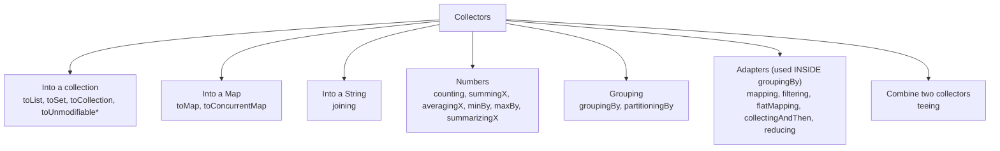

Data: `emps`, `names`, `nums` as at the top.

## A. Into a collection
| Collector | Use when | Example |
|---|---|---|
| `toList()` | need a List | `names.stream().collect(Collectors.toList())` |
| `toSet()` | need unique values | `nums.stream().collect(Collectors.toSet())` |
| `toCollection(Supplier)` | need a specific type (TreeSet, LinkedList, ArrayDeque) | `names.stream().collect(Collectors.toCollection(TreeSet::new))` (sorted + unique) |
| `toUnmodifiableList/Set/Map` | read-only result | `nums.stream().collect(Collectors.toUnmodifiableList())` |

`stream.toList()` (Java 16) is the short form of immutable list; `Collectors.toList()` gives a mutable ArrayList (not guaranteed, but usually).

## B. Into a Map - `toMap`
```java
toMap(keyFn, valueFn)
toMap(keyFn, valueFn, mergeFn)               // handles duplicate keys
toMap(keyFn, valueFn, mergeFn, mapSupplier)  // choose map type
```
```java
emps.stream().collect(toMap(Emp::id, Emp::name));                  // {1=John, 2=Alice,...}
emps.stream().collect(toMap(Emp::id, e -> e));                     // id -> whole object (use Function.identity())
names.stream().collect(toMap(n -> n, n -> 1, Integer::sum));       // word count (duplicates summed)
emps.stream().collect(toMap(Emp::dept, Emp::salary, Double::sum, TreeMap::new)); // dept total, sorted by dept
names.stream().collect(toMap(n -> n, String::length, (a, b) -> a, LinkedHashMap::new)); // keep insertion order
```
Gotchas: duplicate key without merge fn -> `IllegalStateException`; null value -> NPE.
Use when: you want a **lookup table** (id -> object, word -> count).

## C. Into a String - `joining`
```java
names.stream().collect(joining());                    // johnalicebob...
names.stream().collect(joining(", "));                // john, alice, bob...
names.stream().collect(joining(", ", "[", "]"));      // [john, alice, ...]  (delimiter, prefix, suffix)
```
Only works on `Stream<String>` (or `CharSequence`) -> `map(String::valueOf)` first for numbers:
`nums.stream().map(String::valueOf).collect(joining("-"))`.
Use when: building CSV, display text, ids list.

## D. Numeric collectors (usually used inside groupingBy)
| Collector | Result | Example |
|---|---|---|
| `counting()` | Long | `emps.stream().collect(counting())` -> 5 |
| `summingInt/Long/Double(fn)` | number | `summingDouble(Emp::salary)` |
| `averagingInt/Long/Double(fn)` | Double | `averagingInt(Emp::age)` |
| `minBy(cmp)` / `maxBy(cmp)` | Optional<T> | `maxBy(Comparator.comparingDouble(Emp::salary))` |
| `summarizingInt/Long/Double(fn)` | stats object | `summarizingDouble(Emp::salary)` -> min,max,avg,sum,count |
| `reducing(identity, fn)` / `reducing(identity, mapper, op)` | T | `reducing(0.0, Emp::salary, Double::sum)` |

Standalone use is rare (a stream op like `count()`, `sum()` is shorter); they shine **inside groupingBy**.

## E. Grouping - `groupingBy`
```java
groupingBy(classifier)                              // Map<K, List<T>>
groupingBy(classifier, downstream)                  // Map<K, whatever downstream makes>
groupingBy(classifier, mapFactory, downstream)      // choose map type (TreeMap / LinkedHashMap)
```
```java
emps.stream().collect(groupingBy(Emp::dept));                                   // dept -> List<Emp>
emps.stream().collect(groupingBy(Emp::dept, counting()));                       // dept -> count
emps.stream().collect(groupingBy(Emp::dept, summingDouble(Emp::salary)));       // dept -> total salary
emps.stream().collect(groupingBy(Emp::dept, averagingDouble(Emp::salary)));     // dept -> avg salary
emps.stream().collect(groupingBy(Emp::dept, mapping(Emp::name, toList())));     // dept -> names
emps.stream().collect(groupingBy(Emp::dept, TreeMap::new, counting()));         // sorted by dept
emps.stream().collect(groupingBy(e -> e.age() >= 35 ? "Senior" : "Junior"));    // custom key
emps.stream().collect(groupingBy(Emp::dept, groupingBy(e -> e.age() > 30)));    // multi-level
names.stream().collect(groupingBy(String::length));                             // length -> words
"banana".chars().mapToObj(c -> (char) c).collect(groupingBy(c -> c, counting()));// char frequency
```
Use when you see: **"-wise", "per", "each", "for every", "frequency", "category", "group by"**.

## F. Partitioning - `partitioningBy`
Always gives exactly two keys: `true` and `false`.
```java
emps.stream().collect(partitioningBy(e -> e.salary() > 55000));                 // {false=[...], true=[...]}
emps.stream().collect(partitioningBy(e -> e.age() > 30, counting()));           // {false=2, true=3}
nums.stream().collect(partitioningBy(n -> n % 2 == 0));                         // even / odd
```
Use when: **two buckets** (pass/fail, even/odd, prime/non-prime). Unlike groupingBy, an empty bucket still appears.

## G. Adapter collectors (only make sense as a downstream)
Think: "after grouping, do one more thing inside each group".
| Collector | Meaning | Example |
|---|---|---|
| `mapping(fn, downstream)` | map then collect (like `map` inside a group) | `groupingBy(Emp::dept, mapping(Emp::name, toList()))` |
| `filtering(pred, downstream)` | filter inside group (keeps empty groups!) | `groupingBy(Emp::dept, filtering(e -> e.salary() > 50000, toList()))` |
| `flatMapping(fn, downstream)` | flatMap inside group | `groupingBy(k, flatMapping(x -> x.tags().stream(), toSet()))` |
| `collectingAndThen(downstream, finisher)` | post-process the result | `collectingAndThen(toList(), Collections::unmodifiableList)` |
| `reducing(...)` | reduce inside group | `groupingBy(Emp::dept, reducing(0.0, Emp::salary, Double::sum))` |

`filter` before grouping drops groups with no match; `filtering` inside keeps the key with an empty list.

`collectingAndThen` is the go-to for **Optional unwrapping**:
```java
// dept -> name of highest paid
emps.stream().collect(groupingBy(Emp::dept,
    collectingAndThen(maxBy(Comparator.comparingDouble(Emp::salary)), o -> o.get().name())));
// size of a collected list
names.stream().collect(collectingAndThen(toList(), List::size));
```

## H. `teeing` (Java 12) - two collectors in one pass, then merge
```java
emps.stream().collect(Collectors.teeing(
    summingDouble(Emp::salary), counting(), (sum, cnt) -> sum / cnt));   // average salary manually
// min and max together
nums.stream().collect(Collectors.teeing(
    minBy(Integer::compare), maxBy(Integer::compare), (mn, mx) -> mn.get() + "-" + mx.get()));
```
Use when: you need two results from the same stream (a stream can be used only once).

## Collector decision chart
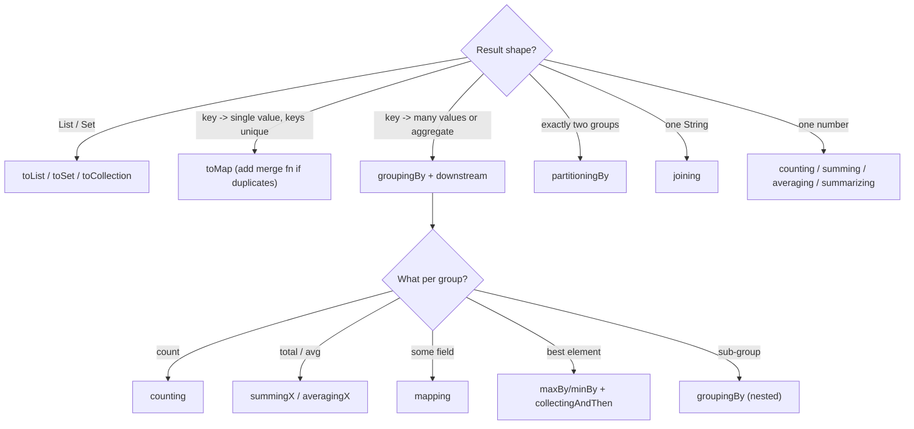

## Collectors practice
- **Easy:** Unique sorted names -> `names.stream().collect(toCollection(TreeSet::new));`
- **Easy:** Count per dept -> `groupingBy(Emp::dept, counting())`
- **Medium:** Dept -> comma separated names -> `groupingBy(Emp::dept, mapping(Emp::name, joining(", ")))`
- **Medium:** Salary stats -> `emps.stream().collect(summarizingDouble(Emp::salary))`
- **Hard:** Dept -> top earner's name -> see `collectingAndThen` above.
- **Hard:** Dept -> list of names of those earning > 50000 (keep all depts) -> `groupingBy(Emp::dept, filtering(e -> e.salary() > 50000, mapping(Emp::name, toList())))`
- **Hard:** Min and max age in one pass -> `teeing`.

---

# 12. COMPARATOR (all of them, with where to use)

A Comparator answers: **"which of these two comes first?"** `compare(a, b)` returns
- **negative** -> a before b
- **0** -> equal
- **positive** -> a after b

Used by: `sorted`, `min`, `max`, `TreeMap/TreeSet`, `Collections.sort`, `list.sort`, `maxBy/minBy`, `PriorityQueue`.

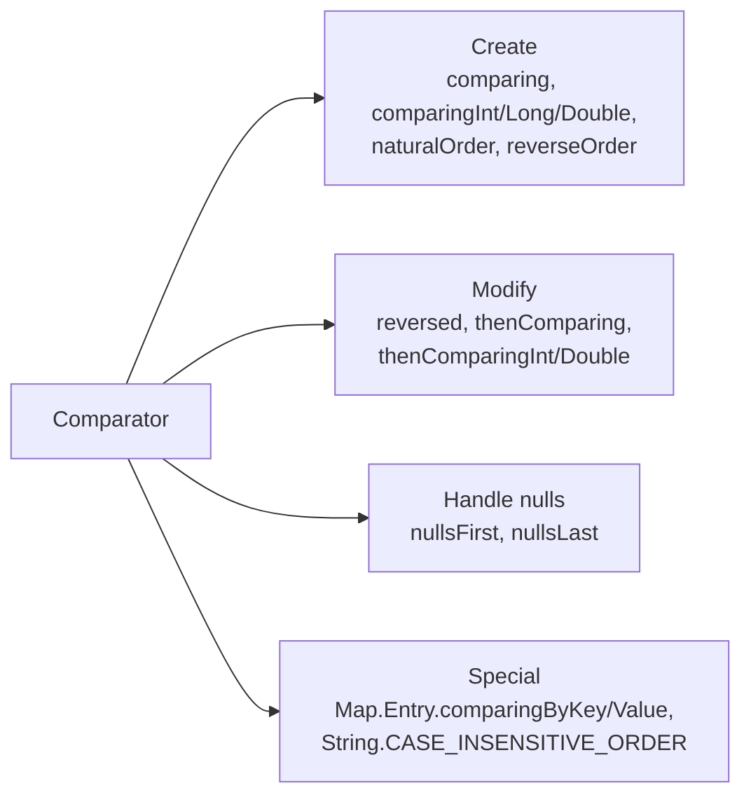

## A. Creating comparators
| Method | Meaning | Example |
|---|---|---|
| `Comparator.naturalOrder()` | default order (a-z, 1-9) | `sorted(Comparator.naturalOrder())` same as `sorted()` |
| `Comparator.reverseOrder()` | opposite of natural | `nums.stream().sorted(Comparator.reverseOrder())` |
| `Comparator.comparing(keyExtractor)` | sort by a field (objects) | `Comparator.comparing(Emp::name)` |
| `Comparator.comparing(keyExtractor, keyComparator)` | by field with custom order | `comparing(Emp::name, Comparator.reverseOrder())` |
| `comparingInt / comparingLong / comparingDouble` | by primitive field (no boxing, faster) | `comparingDouble(Emp::salary)` |
| lambda `(a, b) -> ...` | fully custom | `(a, b) -> a.length() - b.length()` |

```java
emps.stream().sorted(Comparator.comparing(Emp::name)).toList();           // A-Z by name
emps.stream().sorted(Comparator.comparingDouble(Emp::salary)).toList();   // low -> high
names.stream().sorted(Comparator.comparing(String::length)).toList();     // shortest first
```
**Lambda danger:** `(a, b) -> a - b` can overflow for big ints. Prefer `Integer.compare(a, b)` or `comparingInt`.

## B. Modifying comparators
| Method | Meaning | Example |
|---|---|---|
| `.reversed()` | flip the order | `comparingDouble(Emp::salary).reversed()` -> high to low |
| `.thenComparing(...)` | tie-breaker | `comparing(Emp::dept).thenComparing(Emp::name)` |
| `.thenComparingInt/Long/Double` | tie-breaker on primitive | `.thenComparingInt(Emp::age)` |
| `.thenComparing(key, cmp)` | tie-breaker with custom order | `.thenComparing(Emp::salary, Comparator.reverseOrder())` |

```java
// dept A-Z, then salary high -> low, then name
emps.stream().sorted(
    Comparator.comparing(Emp::dept)
              .thenComparing(Emp::salary, Comparator.reverseOrder())
              .thenComparing(Emp::name)).toList();
```
**Trap with `.reversed()`:** it reverses the **whole chain built so far**.
```java
comparing(Emp::dept).thenComparing(Emp::salary).reversed();   // BOTH reversed
comparing(Emp::dept).thenComparing(Emp::salary, Comparator.reverseOrder()); // only salary reversed
```
**Trap with lambdas + reversed:** `comparing(e -> e.salary()).reversed()` fails type inference; use `Emp::salary` or `Comparator.<Emp,Double>comparing(e -> e.salary()).reversed()`.

## C. Null handling
```java
Comparator.nullsFirst(Comparator.naturalOrder());     // nulls at start
Comparator.nullsLast(Comparator.comparing(Emp::name)); // nulls at end
list.stream().sorted(Comparator.comparing(Emp::nickname, Comparator.nullsLast(Comparator.naturalOrder())));
```
Use when the **sort field itself may be null** (otherwise NPE).

## D. Special comparators
```java
String.CASE_INSENSITIVE_ORDER                              // "a" == "A"
names.stream().sorted(String.CASE_INSENSITIVE_ORDER);

Map.Entry.comparingByKey();                                // sort map by key
Map.Entry.comparingByValue();                              // sort map by value
Map.Entry.<String,Integer>comparingByValue().reversed();   // value high -> low
Map.Entry.comparingByValue(Comparator.reverseOrder());     // same, no inference issue
```
```java
// sort map by value desc, keep order in LinkedHashMap
map.entrySet().stream()
   .sorted(Map.Entry.comparingByValue(Comparator.reverseOrder()))
   .collect(toMap(Map.Entry::getKey, Map.Entry::getValue, (a, b) -> a, LinkedHashMap::new));
```

## E. Where comparators are used
| Place | Example |
|---|---|
| `sorted` | `emps.stream().sorted(cmp)` |
| `min` / `max` | `emps.stream().max(Comparator.comparingInt(Emp::age))` |
| `Collectors.maxBy/minBy` | `groupingBy(Emp::dept, maxBy(cmp))` |
| `List.sort` | `list.sort(cmp)` |
| `Collections.sort/max/min` | `Collections.sort(list, cmp)` |
| `TreeSet` / `TreeMap` | `new TreeSet<>(Comparator.comparing(Emp::name))` |
| `PriorityQueue` | `new PriorityQueue<>(Comparator.comparingDouble(Emp::salary).reversed())` (max-heap) |
| `Arrays.sort` | `Arrays.sort(arr, Comparator.reverseOrder())` (needs `Integer[]`, not `int[]`) |

## Which one do I write? (quick guide)
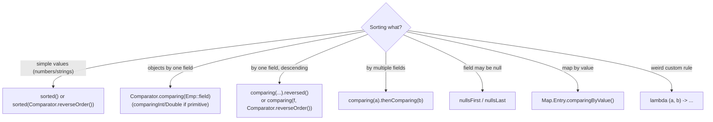

## Comparator practice
- **Easy:** Sort names by length -> `names.stream().sorted(Comparator.comparing(String::length)).toList();`
- **Easy:** Highest salary employee -> `emps.stream().max(Comparator.comparingDouble(Emp::salary)).get();`
- **Medium:** Dept A-Z, then salary high -> low (see example above).
- **Medium:** Case-insensitive sort -> `names.stream().sorted(String.CASE_INSENSITIVE_ORDER).toList();`
- **Medium:** Max-heap of ints -> `new PriorityQueue<>(Comparator.reverseOrder());`
- **Hard:** Sort strings by length desc, then alphabetically ->
  `names.stream().sorted(Comparator.comparing(String::length, Comparator.reverseOrder()).thenComparing(Comparator.naturalOrder())).toList();`
- **Hard:** Sort employees by nickname with nulls last, then by id ->
  `Comparator.comparing(Emp::nickname, Comparator.nullsLast(Comparator.naturalOrder())).thenComparingInt(Emp::id)`
- **Hard:** Top 3 words by frequency, ties broken alphabetically ->
  ```java
  freqMap.entrySet().stream()
      .sorted(Map.Entry.<String,Long>comparingByValue().reversed().thenComparing(Map.Entry.comparingByKey()))
      .limit(3).toList();
  ```

---

# QUICK REVISION CARD

- **Lambda** = `(input) -> result`; works only for functional interfaces. Predicate=question, Function=convert, Consumer=use, Supplier=give, BinaryOperator=combine.
- **Method ref** = lambda that just calls one method: `Class::staticM`, `obj::m`, `Class::instanceM`, `Class::new`.
- **Pipeline** = source -> intermediates (lazy) -> one terminal (trigger). Stream is single-use.
- **Intermediate:** filter, map, mapToX, mapToObj, boxed, flatMap, mapMulti, distinct, sorted, peek, limit, skip, takeWhile, dropWhile.
- **Terminal:** forEach, collect, toList, toArray, reduce, count, min, max, sum, average, summaryStatistics, anyMatch, allMatch, noneMatch, findFirst, findAny, iterator.
- **Approach:** decide the *output type* first (terminal), then work backwards: what to keep (filter), what to convert (map), what order/limit (sorted/limit).
- **Collectors:** toList/toSet/toCollection, toMap (merge fn!), joining, counting/summing/averaging/summarizing, minBy/maxBy, groupingBy (+downstream: mapping, filtering, collectingAndThen), partitioningBy, teeing.
- **Comparator:** comparing/comparingInt/Double, naturalOrder/reverseOrder, `.reversed()` (reverses whole chain), `.thenComparing()`, nullsFirst/nullsLast, Map.Entry.comparingByValue/Key.
- **Common traps:** infinite streams need `limit`; `Optional` must be unwrapped; `toMap` duplicate keys throw; `IntStream` needs `boxed()` for collectors; don't mutate outside variables in lambdas; use `LinkedHashMap` to preserve sorted map order.
