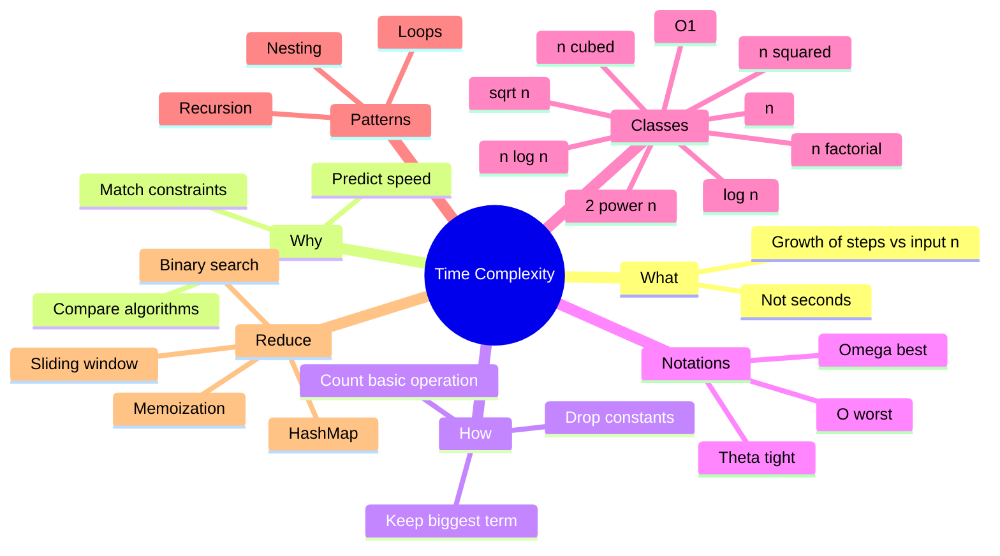
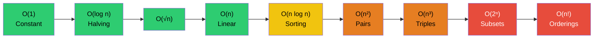
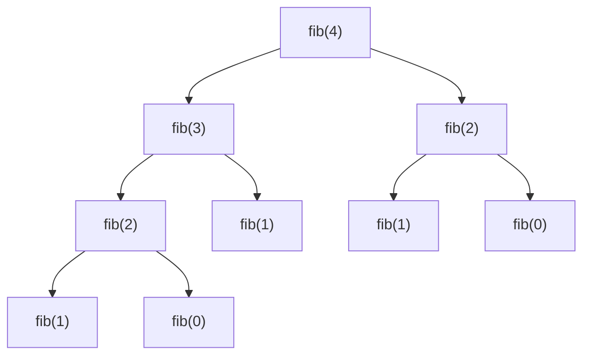
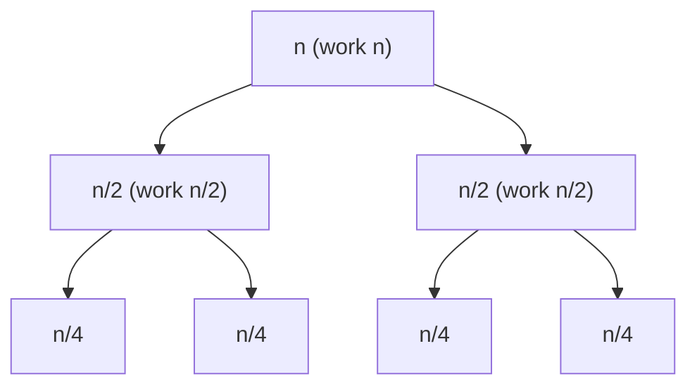
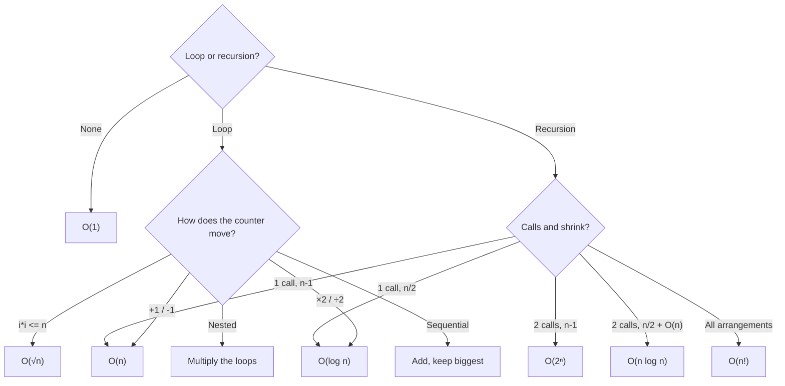
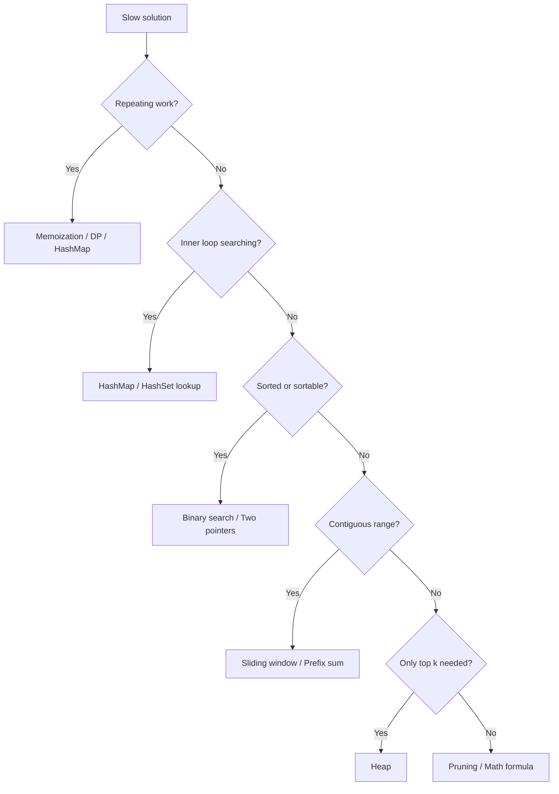

# Time Complexity — Complete Notes for Revision

> Goal: understand it once, remember it forever. Every chapter ends with a **Remember** line.

## Table of Contents

1. [What is Time Complexity?](#1-what-is-time-complexity)
2. [Why is it needed?](#2-why-is-it-needed)
3. [How is it calculated?](#3-how-is-it-calculated)
4. [Types of Time Complexity (Cases & Notations)](#4-types-of-time-complexity-cases--notations)
5. [All Time Complexities at a Glance](#5-all-time-complexities-at-a-glance)
6. [Each Complexity Explained](#6-each-complexity-explained)
7. [Patterns in Time Complexity](#7-patterns-in-time-complexity)
8. [How to Identify the Pattern](#8-how-to-identify-the-pattern)
9. [Examples for Every Scenario](#9-examples-for-every-scenario)
10. [Identifying & Calculating in Real Problems](#10-identifying--calculating-in-real-problems)
11. [Steps to Reduce Time Complexity](#11-steps-to-reduce-time-complexity)
12. [Miscellaneous Important Topics](#12-miscellaneous-important-topics)
13. [One-Page Cheat Sheet](#13-one-page-cheat-sheet)

### Big picture (mind map)



---

## 1. What is Time Complexity?

**Time complexity = how the number of steps an algorithm takes grows as the input size `n` grows.**

- It is **not** seconds. Seconds depend on your laptop, language, and load.
- It is the **growth rate**: "If I double the input, what happens to the work?"

### Real-life analogy
Finding a name in a phone book:

| Method | What happens when the book gets 2x bigger |
|---|---|
| Read every page from the start | Work doubles → **O(n)** |
| Open the middle, discard half, repeat | One extra step → **O(log n)** |
| Know the exact page number | No change → **O(1)** |

> **Remember:** Time complexity answers *"how does work grow when input grows?"*

---

## 2. Why is it needed?

1. **Machine independent** – lets us compare two algorithms fairly.
2. **Predict before running** – tells us whether code will survive large inputs (1 million items) *before* we run it.
3. **Pick the right approach** – brute force vs optimized solution.
4. **Interviews / competitive coding** – constraints on `n` hint at the expected complexity (see [Chapter 12](#12-miscellaneous-important-topics)).
5. **Real systems** – an O(n²) code that works for 100 users may crash at 1,000,000 users.

Example: `n = 100,000`

| Complexity | Operations | Verdict |
|---|---|---|
| O(n) | 100,000 | instant |
| O(n log n) | ~1.7 million | instant |
| O(n²) | 10,000,000,000 | too slow (minutes) |

> **Remember:** Correct code that is too slow is still a wrong answer in DSA.

---

## 3. How is it calculated?

### The 5-step method

1. **Find the basic operation** – the line that does the real work (comparison, assignment, print). Ignore one-time setup.
2. **Count how many times it runs** in terms of `n`.
3. **Drop constants**: `3n → n`, `n/2 → n`.
4. **Keep only the highest-order term**: `n² + n + 5 → n²`.
5. **For recursion**, use the recursion table (Ch. 7) or the Master Theorem (Ch. 12).

### Why drop constants and lower terms?
For huge `n`, the biggest term dominates everything.

`n = 1,000,000` → `n² = 10¹²`, while `n = 10⁶`. The `n` part is a rounding error.

### Worked example

```java
int sum = 0;                       // 1 step
for (int i = 0; i < n; i++) {      // runs n times
    sum += i;                      // 1 step each → n steps
}
System.out.println(sum);           // 1 step
```

Total = `1 + n + 1 = n + 2` → drop the `2` → **O(n)**

> **Remember:** Count → drop constants → keep the biggest term.

---

## 4. Types of Time Complexity (Cases & Notations)

### 4.1 Types by *case* (which input are we talking about?)

| Case | Meaning | Example (linear search) |
|---|---|---|
| **Best case** | Luckiest input | Element is at index 0 → 1 step |
| **Average case** | Typical/random input | Found in the middle → n/2 steps |
| **Worst case** | Unluckiest input | Element is last or missing → n steps |

We almost always analyze the **worst case** — it is a guarantee ("never slower than this").

### 4.2 Types by *notation* (how do we write the bound?)

| Notation | Name | Meaning | Think of it as |
|---|---|---|---|
| **O (Big-O)** | Upper bound | Grows **no faster than** | "at most" (≤) |
| **Ω (Omega)** | Lower bound | Grows **at least as fast as** | "at least" (≥) |
| **Θ (Theta)** | Tight bound | Both upper and lower | "exactly" (=) |

> In interviews, "time complexity" means **Big-O of the worst case**.

### 4.3 Types by *behavior*
- **Constant**, **Logarithmic**, **Linear**, **Polynomial**, **Exponential**, **Factorial** – covered next.
- **Amortized** – average cost over many operations (Ch. 12).

> **Remember:** Case = which input. Notation = how we express the bound. Default = Big-O worst case.

---

## 5. All Time Complexities at a Glance

Fastest → slowest:

| # | Notation | Name | Typical example |
|---|---|---|---|
| 1 | O(1) | Constant | Array access, HashMap get |
| 2 | O(log n) | Logarithmic | Binary search |
| 3 | O(√n) | Square root | Prime check |
| 4 | O(n) | Linear | Single loop, linear search |
| 5 | O(n log n) | Linearithmic | Merge sort, heap sort |
| 6 | O(n²) | Quadratic | Nested loops, bubble sort |
| 7 | O(n³) | Cubic | Triple loop, matrix multiplication |
| 8 | O(2ⁿ) | Exponential | Naive Fibonacci, all subsets |
| 9 | O(n!) | Factorial | All permutations, brute-force TSP |

### Numbers for n = 10

| Complexity | Value |
|---|---|
| O(1) | 1 |
| O(log n) | ~3 |
| O(√n) | ~3 |
| O(n) | 10 |
| O(n log n) | ~33 |
| O(n²) | 100 |
| O(n³) | 1,000 |
| O(2ⁿ) | 1,024 |
| O(n!) | 3,628,800 |

### Numbers for n = 1,000,000 (feel the difference)

| Complexity | Approx. steps |
|---|---|
| O(1) | 1 |
| O(log n) | 20 |
| O(√n) | 1,000 |
| O(n) | 1 million |
| O(n log n) | 20 million |
| O(n²) | 1 trillion ❌ |
| O(2ⁿ), O(n!) | impossible ❌ |

**Memory trick (order):** *"**C**ats **L**ove **S**leeping **L**ong **L**azy **Q**uiet **C**orners, **E**very **F**ull day"*
→ **C**onstant, **L**og, **S**qrt, **L**inear, **L**inearithmic, **Q**uadratic, **C**ubic, **E**xponential, **F**actorial.



Green = fast, yellow/orange = careful, red = tiny `n` only.

> **Remember:** Anything up to O(n log n) is good. O(n²) is borderline. O(2ⁿ)/O(n!) only for tiny n.

---

## 6. Each Complexity Explained

### 6.1 O(1) — Constant
Work does **not** depend on `n`. Same effort for 10 or 10 million items.

- Analogy: Opening a book to a known page number.
- Examples: `arr[5]`, `map.get(key)`, `stack.push()`, swapping two variables, `n % 2`.

### 6.2 O(log n) — Logarithmic
Each step **cuts the problem by a fraction (usually half)**. Super fast.

- Analogy: Guess a number between 1 and 1000: "Is it above 500?" → 10 questions max.
- `log₂(1,000,000) ≈ 20`. A million items need only ~20 steps.
- Examples: binary search, loops that do `i *= 2` / `i /= 2`, balanced BST search.

### 6.3 O(√n) — Square root
Loop runs only until `i * i <= n`.

- Analogy: To check whether 100 is prime, you only test divisors up to 10.
- Why: divisors come in pairs (`a × b = n`), so one of them is always ≤ √n.
- Examples: prime check, finding all divisors of `n`.

### 6.4 O(n) — Linear
Touch every element **once**.

- Analogy: Reading every page of a book once.
- Examples: sum of array, find max, linear search, traversing a linked list.

### 6.5 O(n log n) — Linearithmic
Do an O(log n) job **for each of n items**, or split in half repeatedly and do O(n) work at every level.

- Analogy: Sorting a deck by repeatedly splitting it in half, then merging.
- Examples: merge sort, heap sort, quick sort (average), sorting then scanning.
- This is the **best possible for comparison-based sorting**.

### 6.6 O(n²) — Quadratic
For each element, you look at **every other element**. Nested loops.

- Analogy: Everyone in a room shakes hands with everyone else.
- Examples: bubble / selection / insertion sort, comparing all pairs, printing a 2D grid.

### 6.7 O(n³) — Cubic
Three nested loops over `n`.

- Examples: naive matrix multiplication, Floyd–Warshall (all-pairs shortest path).

### 6.8 O(2ⁿ) — Exponential
Work **doubles with every extra element**. Each element has 2 choices (take / skip).

- Analogy: Every new item doubles the number of possible outfits.
- Examples: all subsets, naive recursive Fibonacci, brute-force on choices.
- Usable only for `n ≤ ~20-25`.

### 6.9 O(n!) — Factorial
Try **every possible ordering**. Grows insanely fast: `10! = 3.6 million`, `20! = 2.4 × 10¹⁸`.

- Examples: all permutations, brute-force Travelling Salesman.
- Usable only for `n ≤ ~10`.

> **Remember:** halving → log; once through → n; pair up → n²; choose/skip → 2ⁿ; order → n!.

---

## 7. Patterns in Time Complexity

All complexity boils down to **a few repeating patterns**. Learn the patterns, not the programs.

### 7.1 Loop patterns

| Loop shape | Complexity |
|---|---|
| No loop, direct statements | O(1) |
| `i++` / `i--` / `i += k` | O(n) |
| `i *= 2` / `i /= 2` | O(log n) |
| `i * i <= n` | O(√n) |

### 7.2 Combining loops

| Structure | Rule | Result |
|---|---|---|
| One after another (sequential) | **Add**, keep the biggest | O(n) + O(n²) → O(n²) |
| Inside each other (nested) | **Multiply** | O(n) × O(n) → O(n²) |
| Normal loop with log loop inside | **Multiply** | O(n) × O(log n) → O(n log n) |

### 7.3 Recursion patterns
Ask 2 questions: **(1) how many calls per call? (2) how much does the input shrink?**

| Pattern | Calls | Input shrinks | Complexity | Example |
|---|---|---|---|---|
| A | 1 | −1 | O(n) | factorial, countdown |
| B | 1 | ÷2 | O(log n) | recursive binary search |
| C | 2 | −1 | O(2ⁿ) | naive Fibonacci |
| D | 2 | ÷2 + O(n) merge | O(n log n) | merge sort |
| E | n choices, shrinking | −1 | O(n!) | permutations |

### 7.4 Data-structure patterns

| Idea | Complexity |
|---|---|
| Direct access (array index, hash) | O(1) |
| Tree / halving search | O(log n) |
| Scan everything | O(n) |
| Sort first, then work | O(n log n) |
| Every pair | O(n²) |
| Every subset | O(2ⁿ) |
| Every ordering | O(n!) |

### Recursion trees (visual memory)

**Naive Fibonacci — 2 calls, shrink by 1 → the tree doubles each level → O(2ⁿ)**



**Merge sort — 2 calls, halve; every level does n work; log n levels → O(n log n)**


Each level adds up to `n`, and there are `log n` levels → `n × log n`.

> **Remember:** Patterns = *how the counter moves* + *how loops are arranged* + *how recursion splits*.

---

## 8. How to Identify the Pattern

### 8.1 Decision flow (use on any code)

```
Is there a loop or recursion?
 ├─ No  → O(1)
 ├─ Loop:
 │    ├─ counter +1 / -1            → O(n)
 │    ├─ counter ×2 or ÷2           → O(log n)
 │    ├─ condition i*i <= n         → O(√n)
 │    ├─ nested?                    → MULTIPLY the loops
 │    └─ sequential?                → ADD, keep biggest
 └─ Recursion:
      ├─ 1 call, n-1               → O(n)
      ├─ 1 call, n/2               → O(log n)
      ├─ 2 calls, n-1              → O(2ⁿ)
      ├─ 2 calls, n/2 + O(n) work  → O(n log n)
      └─ tries all arrangements    → O(n!)
```

Same flow as a diagram:



### 8.2 Keyword hints from problem statements

| Words in the problem | Likely complexity |
|---|---|
| "sorted array", "search", "find position" | O(log n) |
| "traverse / each element once" | O(n) |
| "sort", "k largest", "merge intervals" | O(n log n) |
| "all pairs", "two nested comparisons" | O(n²) |
| "all subsets", "include / exclude" | O(2ⁿ) |
| "all permutations / arrangements" | O(n!) |
| "prime", "divisors" | O(√n) |

### 8.3 Dependent inner loops (tricky!)

```java
// Triangular loop: inner depends on outer
for (int i = 0; i < n; i++)
    for (int j = 0; j < i; j++) { ... }
// 0 + 1 + 2 + ... + (n-1) = n(n-1)/2  → O(n²)
```

```java
// Inner loop doubles while outer is linear
for (int i = 0; i < n; i++)
    for (int j = 1; j < n; j *= 2) { ... }
// n × log n → O(n log n)
```

```java
// Outer loop doubles, inner runs i times
for (int i = 1; i < n; i *= 2)
    for (int j = 0; j < i; j++) { ... }
// 1 + 2 + 4 + ... + n ≈ 2n → O(n)   (surprise: NOT n log n)
```

### 8.4 Different inputs → different variables

```java
for (int i = 0; i < a.length; i++)
    for (int j = 0; j < b.length; j++) { ... }
// O(a × b), NOT O(n²). Use separate variables!
```

> **Remember:** Look at the counter, look at the nesting, look at the recursion split.

---

## 9. Examples for Every Scenario

### 9.1 O(1)

```java
int getFirst(int[] arr) {
    return arr[0];                 // one step regardless of size
}

boolean isEven(int n) {
    return n % 2 == 0;
}
```

### 9.2 O(log n)

```java
// Loop doubling
for (int i = 1; i < n; i *= 2) {
    System.out.println(i);         // n=16 → 1,2,4,8 → 4 prints
}

// Binary search (sorted array)
int binarySearch(int[] arr, int target) {
    int lo = 0, hi = arr.length - 1;
    while (lo <= hi) {
        int mid = lo + (hi - lo) / 2;
        if (arr[mid] == target) return mid;
        if (arr[mid] < target) lo = mid + 1;
        else hi = mid - 1;
    }
    return -1;
}
```

Counting digits (`while (n > 0) { n /= 10; }`) is also **O(log n)** (base 10).

### 9.3 O(√n)

```java
boolean isPrime(int n) {
    if (n < 2) return false;
    for (int i = 2; i * i <= n; i++) {
        if (n % i == 0) return false;
    }
    return true;
}
```

### 9.4 O(n)

```java
int findMax(int[] arr) {
    int max = arr[0];
    for (int x : arr) {
        if (x > max) max = x;
    }
    return max;
}

// Two sequential loops: O(n) + O(n) = O(2n) → O(n)
for (int i = 0; i < n; i++) { ... }
for (int j = 0; j < n; j++) { ... }
```

### 9.5 O(n log n)

```java
// Loop × log loop
for (int i = 0; i < n; i++)
    for (int j = 1; j < n; j *= 2)
        System.out.println(i + "," + j);

// Sorting is O(n log n)
Arrays.sort(arr);

// Merge sort
void mergeSort(int[] a, int l, int r) {
    if (l >= r) return;
    int mid = (l + r) / 2;
    mergeSort(a, l, mid);          // T(n/2)
    mergeSort(a, mid + 1, r);      // T(n/2)
    merge(a, l, mid, r);           // O(n)
}
```

### 9.6 O(n²)

```java
// Nested loops
for (int i = 0; i < n; i++)
    for (int j = 0; j < n; j++)
        System.out.println(i + "," + j);

// Bubble sort
for (int i = 0; i < n - 1; i++)
    for (int j = 0; j < n - i - 1; j++)
        if (a[j] > a[j + 1]) { int t = a[j]; a[j] = a[j + 1]; a[j + 1] = t; }

// Check every pair
for (int i = 0; i < n; i++)
    for (int j = i + 1; j < n; j++)
        if (a[i] + a[j] == target) { /* found */ }
```

### 9.7 O(n³)

```java
for (int i = 0; i < n; i++)
    for (int j = 0; j < n; j++)
        for (int k = 0; k < n; k++)
            C[i][j] += A[i][k] * B[k][j];   // matrix multiplication
```

### 9.8 O(2ⁿ)

```java
int fib(int n) {
    if (n <= 1) return n;
    return fib(n - 1) + fib(n - 2);   // 2 calls, shrink by 1
}

// Generate all subsets: each element is "take" or "skip"
void subsets(int[] a, int i, List<Integer> cur) {
    if (i == a.length) { System.out.println(cur); return; }
    subsets(a, i + 1, cur);                 // skip
    cur.add(a[i]);
    subsets(a, i + 1, cur);                 // take
    cur.remove(cur.size() - 1);
}
```

### 9.9 O(n!)

```java
void permute(int[] a, int idx) {
    if (idx == a.length) { System.out.println(Arrays.toString(a)); return; }
    for (int i = idx; i < a.length; i++) {
        swap(a, idx, i);
        permute(a, idx + 1);
        swap(a, idx, i);       // backtrack
    }
}
// n choices, then n-1, then n-2 ... = n!
```

### 9.10 Recursion O(n) and O(log n)

```java
void countDown(int n) {          // O(n): 1 call, n-1
    if (n == 0) return;
    countDown(n - 1);
}

void halve(int n) {              // O(log n): 1 call, n/2
    if (n == 0) return;
    halve(n / 2);
}
```

---

## 10. Identifying & Calculating in Real Problems

### 10.1 Method for any problem
1. Understand the **input size** (what is `n`? Is there more than one variable?).
2. Write the **brute force** idea → find its complexity.
3. Check constraints: is brute force fast enough? (Ch. 12 table)
4. If not, find the **bottleneck** (usually the nested loop or repeated work) and optimize (Ch. 11).

### 10.2 Problem walk-throughs

#### Problem A — Two Sum (find two numbers adding to target)

| Approach | Idea | Time | Space |
|---|---|---|---|
| Brute force | Check all pairs (nested loop) | O(n²) | O(1) |
| Sort + two pointers | Sort, then move pointers inward | O(n log n) | O(1) |
| HashMap | For each `x`, look up `target - x` | **O(n)** | O(n) |

```java
Map<Integer,Integer> seen = new HashMap<>();
for (int i = 0; i < nums.length; i++) {
    int need = target - nums[i];
    if (seen.containsKey(need)) return new int[]{seen.get(need), i};
    seen.put(nums[i], i);
}
```
One loop (n) × HashMap ops (O(1)) = **O(n)**.

#### Problem B — Check for duplicates

| Approach | Time | Space |
|---|---|---|
| Compare every pair | O(n²) | O(1) |
| Sort, compare neighbors | O(n log n) | O(1) |
| HashSet | O(n) | O(n) |

#### Problem C — Find an element in a sorted array
Linear search = O(n). Binary search = **O(log n)**. Sorted input is a signal for log n.

#### Problem D — Fibonacci

| Approach | Time | Space |
|---|---|---|
| Naive recursion | O(2ⁿ) | O(n) |
| Memoization / DP | O(n) | O(n) |
| Two variables loop | O(n) | **O(1)** |

#### Problem E — Count pairs `(i, j)` with `i < j`

```java
for (int i = 0; i < n; i++)
    for (int j = i + 1; j < n; j++) count++;
```
Iterations = (n−1) + (n−2) + … + 1 = n(n−1)/2 → **O(n²)**.

#### Problem F — Mixed code: what is the complexity?

```java
for (int i = 0; i < n; i++) { ... }                 // O(n)
for (int i = 0; i < n; i++)
    for (int j = 0; j < n; j++) { ... }              // O(n²)
Arrays.sort(arr);                                    // O(n log n)
```
Sequential → add: `n + n² + n log n` → keep biggest → **O(n²)**.

#### Problem G — Sort inside a loop (hidden cost)

```java
for (int i = 0; i < n; i++) {
    Arrays.sort(arr);        // O(n log n) each time!
}
```
Total = n × n log n = **O(n² log n)**. Always remember that **library calls have a cost** (sort, `contains`, `substring`, `String +`).

### 10.3 Hidden costs in Java

| Operation | Cost |
|---|---|
| `list.get(i)` (ArrayList) | O(1) |
| `list.contains(x)` / `list.remove(x)` / `list.add(0, x)` | O(n) |
| `LinkedList.get(i)` | O(n) |
| `map.get/put`, `set.add/contains` (HashMap/HashSet) | O(1) avg |
| `TreeMap` / `TreeSet` ops | O(log n) |
| `PriorityQueue` add/poll | O(log n), peek O(1) |
| `String.substring`, `String +`, `s.equals(t)` | O(length) |
| `StringBuilder.append` | O(1) amortized |
| `Arrays.sort`, `Collections.sort` | O(n log n) |

> **Remember:** Total cost = loops × cost of work inside each loop.

---

## 11. Steps to Reduce Time Complexity

### 11.1 The optimization checklist

Ask yourself in this order:

1. **Am I repeating work?** → store results (HashMap / array / DP / memoization).
2. **Is a nested loop searching for something?** → replace the inner loop with a HashMap/HashSet lookup (O(n) → O(1)).
3. **Is the data sorted (or can it be)?** → binary search or two pointers.
4. **Am I looking at a continuous range?** → sliding window or prefix sums.
5. **Do I need only the best/top k?** → heap instead of full sort.
6. **Is it a choose/skip problem?** → DP / greedy instead of brute-force recursion.
7. **Can I cut the search early?** → pruning, early `break`/`return`.
8. **Can I use math?** → formula instead of a loop.



### 11.2 Techniques with before → after

| Technique | Before | After | Example |
|---|---|---|---|
| **HashMap / HashSet lookup** | O(n²) | O(n) | Two Sum, duplicates |
| **Sorting + two pointers** | O(n²) | O(n log n) | 3Sum, pair sums |
| **Binary search** | O(n) | O(log n) | Search in sorted data |
| **Sliding window** | O(n·k) | O(n) | Max sum of subarray of size k |
| **Prefix sum** | O(n) per query | O(1) per query | Range sum queries |
| **Memoization / DP** | O(2ⁿ) | O(n) or O(n²) | Fibonacci, knapsack |
| **Heap** | O(n log n) | O(n log k) | Top-k elements |
| **Math formula** | O(n) | O(1) | Sum 1..n = n(n+1)/2 |
| **Early exit / pruning** | worst-case heavy | much faster typically | Prime check, backtracking |
| **Better data structure** | varies | varies | Stack/monotonic stack, Trie, Union-Find |

### 11.3 Example — Sliding window

Max sum of any `k` consecutive elements.

```java
// Brute force: O(n * k)
int best = Integer.MIN_VALUE;
for (int i = 0; i + k <= n; i++) {
    int sum = 0;
    for (int j = i; j < i + k; j++) sum += a[j];
    best = Math.max(best, sum);
}

// Optimized: O(n) — reuse the previous window
int sum = 0;
for (int i = 0; i < k; i++) sum += a[i];
int best = sum;
for (int i = k; i < n; i++) {
    sum += a[i] - a[i - k];       // add new, remove old
    best = Math.max(best, sum);
}
```

### 11.4 Example — Prefix sum

```java
int[] prefix = new int[n + 1];
for (int i = 0; i < n; i++) prefix[i + 1] = prefix[i] + a[i];   // O(n) once

int rangeSum(int l, int r) { return prefix[r + 1] - prefix[l]; } // O(1) per query
```

### 11.5 Example — Memoization

```java
long[] memo = new long[n + 1];
long fib(int n) {
    if (n <= 1) return n;
    if (memo[n] != 0) return memo[n];
    return memo[n] = fib(n - 1) + fib(n - 2);    // O(n) instead of O(2ⁿ)
}
```

### 11.6 The trade-off: Time vs Space
Most speedups **spend memory to save time** (HashMap, memo table, prefix array). That is usually a good deal.

> **Remember:** Reduce complexity by **not repeating work**, **not searching blindly**, and **using the right data structure**.

---

## 12. Miscellaneous Important Topics

### 12.1 Space Complexity
Extra memory used **besides the input**.

| Situation | Space |
|---|---|
| A few variables | O(1) |
| New array/list of size n | O(n) |
| Recursion depth d | O(d) (call stack!) |
| n × n matrix | O(n²) |

```java
void countDown(int n) {      // Time O(n), Space O(n) because of recursion stack
    if (n == 0) return;
    countDown(n - 1);
}
```

### 12.2 Constraints → required complexity (VERY useful)
Roughly 10⁸ simple operations per second.

| Input size `n` | Acceptable complexity |
|---|---|
| n ≤ 10 | O(n!) |
| n ≤ 20–25 | O(2ⁿ) |
| n ≤ 500 | O(n³) |
| n ≤ 5,000 | O(n²) |
| n ≤ 10⁵ – 10⁶ | O(n log n) or O(n) |
| n ≤ 10⁸ | O(n) |
| n ≤ 10¹⁸ | O(log n) or O(1) |

Read the constraints first — they tell you what to aim for.

### 12.3 Amortized Time Complexity
Some operations are occasionally expensive but **cheap on average over many calls**.

- `ArrayList.add()`: usually O(1); when full it copies everything (O(n)), but that happens rarely → **amortized O(1)**.
- `StringBuilder.append()` – same idea.

### 12.4 Master Theorem (recursion shortcut)
For `T(n) = a·T(n/b) + O(n^d)`:

| Compare `d` with log_b(a) | Result |
|---|---|
| d < log_b(a) | O(n^(log_b a)) |
| d = log_b(a) | O(n^d · log n) |
| d > log_b(a) | O(n^d) |

- Merge sort: `a=2, b=2, d=1` → log₂2 = 1 = d → **O(n log n)**
- Binary search: `a=1, b=2, d=0` → log₂1 = 0 = d → **O(log n)**

### 12.5 Sorting algorithm complexities

| Algorithm | Best | Average | Worst | Space |
|---|---|---|---|---|
| Bubble | O(n) | O(n²) | O(n²) | O(1) |
| Selection | O(n²) | O(n²) | O(n²) | O(1) |
| Insertion | O(n) | O(n²) | O(n²) | O(1) |
| Merge | O(n log n) | O(n log n) | O(n log n) | O(n) |
| Quick | O(n log n) | O(n log n) | O(n²) | O(log n) |
| Heap | O(n log n) | O(n log n) | O(n log n) | O(1) |

### 12.6 Data structure operation complexities

| Structure | Access | Search | Insert | Delete |
|---|---|---|---|---|
| Array | O(1) | O(n) | O(n) (end O(1)) | O(n) |
| Linked list | O(n) | O(n) | O(1) at head | O(1) at head / O(n) search first |
| Stack / Queue | — | O(n) | O(1) | O(1) |
| HashMap / HashSet | — | O(1) avg, O(n) worst | O(1) avg | O(1) avg |
| Balanced BST / TreeMap | — | O(log n) | O(log n) | O(log n) |
| Unbalanced BST | — | O(n) worst | O(n) worst | O(n) worst |
| Heap | peek O(1) | O(n) | O(log n) | O(log n) |

### 12.7 Graph algorithm complexities (V = vertices, E = edges)

| Algorithm | Complexity |
|---|---|
| BFS / DFS | O(V + E) |
| Dijkstra (min-heap) | O((V + E) log V) |
| Bellman-Ford | O(V · E) |
| Floyd-Warshall | O(V³) |

### 12.8 Common mistakes to avoid

1. **Counting `n` wrongly** – two inputs `a` and `b` give `O(a·b)`, not `O(n²)`.
2. **Forgetting hidden costs** – `contains`, `substring`, string concatenation in a loop (O(n²) total!).
3. **Assuming nested loops are always O(n²)** – check how the counters change (doubling inner loop, dependent bounds).
4. **Confusing space with time** – recursion uses stack space.
5. **Ignoring input type** – for number inputs, `n` is the *value*, and digits count is `log n`.
6. **Thinking O(n) with big constant is slow** – in theory constants are dropped; in practice they matter a bit, but growth rate matters most.

### 12.9 Logarithm refresher
`log₂ n` = "how many times can I halve `n` until I reach 1?"

| n | log₂ n |
|---|---|
| 8 | 3 |
| 1,024 | 10 |
| 1,000,000 | ~20 |
| 1,000,000,000 | ~30 |

The base does not matter in Big-O (`log₂ n` and `log₁₀ n` differ by a constant), so we write **log n**.

### 12.10 Useful math formulas
- `1 + 2 + 3 + … + n = n(n+1)/2` → O(n²)
- `1 + 2 + 4 + … + 2^k ≈ 2^(k+1)` → geometric sum, dominated by the last term
- `n/2 + n/4 + n/8 + … ≈ n` → O(n)
- `log(n!) ≈ n log n` (why comparison sort is O(n log n))

### 12.11 Practical tips
- Always state **both** time and space complexity when you explain a solution.
- Start with brute force, state its complexity, then optimize. Interviewers love this flow.
- Trace small inputs (n = 4, 8) by hand if unsure.
- Big-O says nothing about exact speed — it tells you how it **scales**.

---

## 13. One-Page Cheat Sheet

```
ORDER:   O(1) < O(log n) < O(√n) < O(n) < O(n log n)
         < O(n²) < O(n³) < O(2ⁿ) < O(n!)

LOOPS:
  i++ / i--            → O(n)
  i *= 2 / i /= 2      → O(log n)
  i * i <= n           → O(√n)
  nested loops         → MULTIPLY
  sequential loops     → ADD, keep biggest

RECURSION:
  1 call,  n-1                 → O(n)
  1 call,  n/2                 → O(log n)
  2 calls, n-1                 → O(2ⁿ)
  2 calls, n/2 + O(n) merge    → O(n log n)
  all arrangements             → O(n!)

OPTIMIZE:
  nested search      → HashMap / HashSet
  sorted data        → Binary search / Two pointers
  contiguous range   → Sliding window / Prefix sum
  repeated subcalls  → Memoization / DP
  top-k              → Heap
  formula exists     → Math

CONSTRAINT → TARGET:
  n ≤ 10 → n!    n ≤ 20 → 2ⁿ    n ≤ 500 → n³    n ≤ 5000 → n²
  n ≤ 10⁶ → n log n / n    n ≤ 10¹⁸ → log n

ALWAYS: Count → drop constants → keep the biggest term → mention space too.
```

---
*Next topics to learn after this: Space Complexity in depth → Arrays → Recursion → Sorting & Searching → Hashing → Two pointers / Sliding window → Trees → Graphs → DP.*
